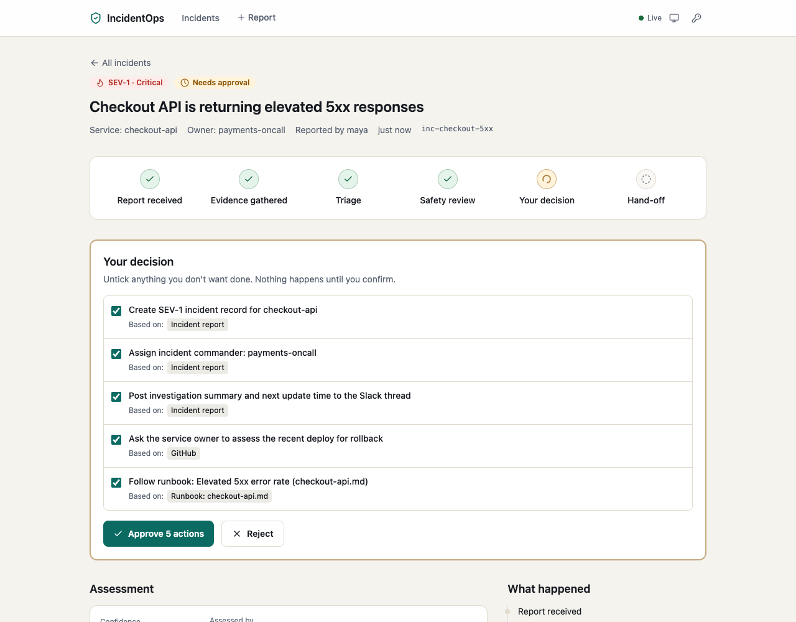
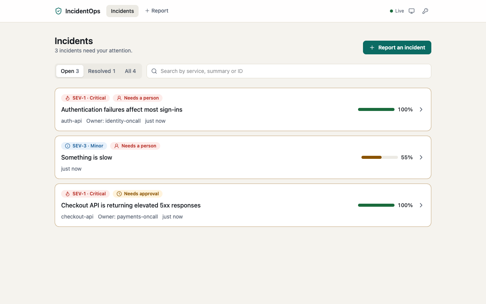
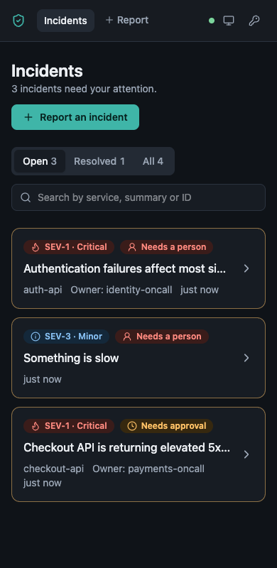
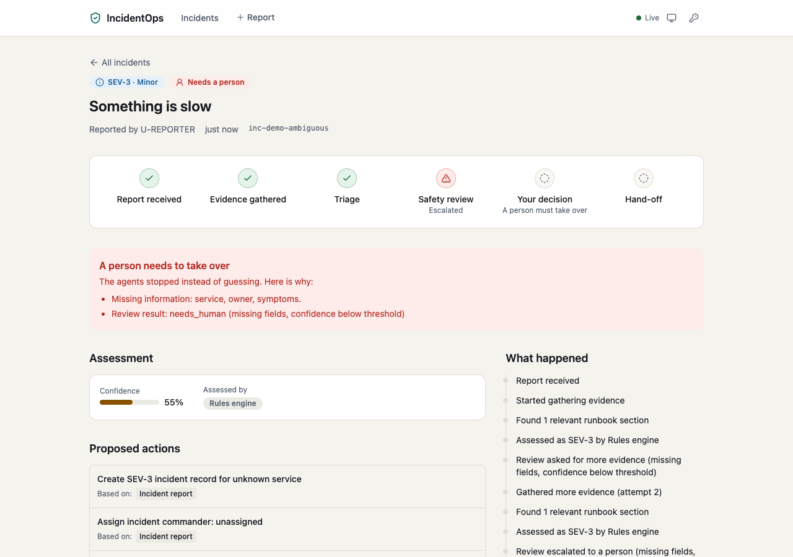
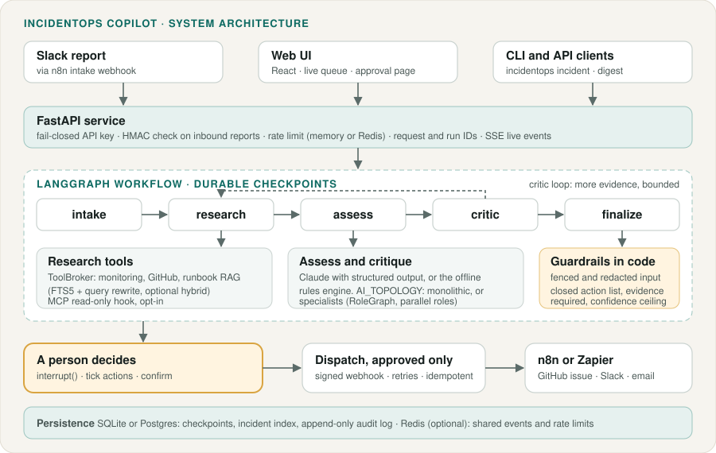
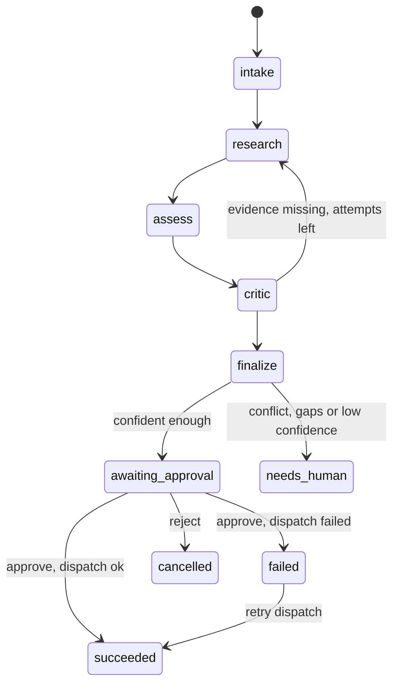
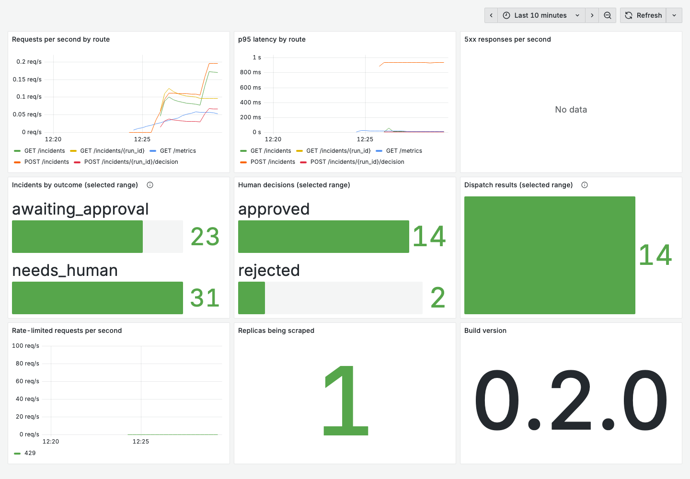
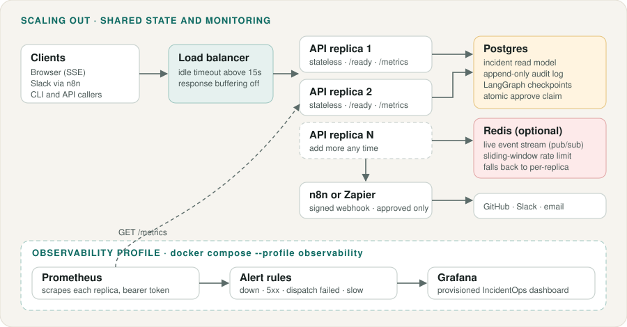

<div align="center">

<p align="center"></p>
<h1 align="center">IncidentOps Copilot: Human-Approved AI Incident Triage</h1>

<p align="center"><b>The AI proposes. A person approves. Only then does anything leave the building.</b></p>

<p align="center">
  <a href="https://github.com/ft-kumarsatyam/incidentops-copilot/actions/workflows/ci.yml"></a>
  
  
  
  
  
  
</p>

<p align="center">
  
  
  
  
  
</p>

<p align="center">
  <a href="https://codespaces.new/ft-kumarsatyam/incidentops-copilot"></a>&nbsp;
  <a href="https://github.com/ft-kumarsatyam/incidentops-copilot/issues"></a>
  <a href="https://github.com/ft-kumarsatyam/incidentops-copilot/pkgs/container/incidentops-copilot"></a>
</p>

<p align="center">
  <a href="README.md"></a>&nbsp;
  <a href="docs/i18n/README.zh-CN.md"></a>&nbsp;
  <a href="docs/i18n/README.hi.md"></a>&nbsp;
  <a href="docs/i18n/README.es.md"></a>
</p>

[Features](#-key-features) · [Get Started](#-get-started) · [Explore](#-explore-incidentops-copilot) · [Evaluation](#-evaluation) · [Observe](#observability) · [CLI](#-command-line) · [Integrations](#-integrations) · [Docs](#-documentation) · [Roadmap](#-status-and-roadmap)

</div>

---

<div align="center">

</div>

> A teammate posts *"checkout is throwing 5xx"* in Slack. Copilot gathers the
> evidence, finds the matching runbook, proposes a severity and a short list of
> reversible actions, and **waits**. The incident commander reviews it in a web
> UI, unticks anything they disagree with, and approves. Only the approved
> actions are sent.

### 📦 What's new

> Current: **v0.2.0** plus unreleased work below. Full history in [CHANGELOG.md](CHANGELOG.md).

- 🛡️ **[Unreleased]** Layered guardrails: output content policy, per-type evidence rules, input injection scanner, critic-output validation. Scored by a new `make eval-guardrails` suite (152 hostile outputs, 29 benign).
- 🗄️ **[Unreleased]** Optional **Postgres** backend and **Redis** for events and rate limits, so several API replicas share state. SQLite stays the default. Versioned migrations with an advisory lock.
- 🔏 **[Unreleased]** Opt-in **webhook security**: HMAC-SHA256 signing with replay protection for n8n and Zapier dispatch, a signature check on `POST /incidents`, and an outbound host allowlist.
- 🔐 **[Unreleased]** n8n workflow: opt-in **Slack signature verification** and a **Redis idempotency claim** (`SET NX` lease) shared by several n8n instances, proven by `make e2e-n8n` against two real n8n containers. Also fixes webhook URLs for CLI/API imports.
- 📈 **[Unreleased]** Opt-in **Prometheus `/metrics`** (bearer-token protected, fail-closed outside dev) and a `docker compose --profile observability` stack with a provisioned Grafana dashboard and alert rules. See [Observability](#observability).
- 🧠 **RoleGraph**: opt-in parallel specialists (impact, change, runbook) on LangGraph, measured against the single-agent baseline. The honest result is [recorded in the report](evals/architecture_report.md).
- 🔎 **Runbook RAG** as its own package: FTS5 plus deterministic query rewrite, with optional hybrid embeddings.

<details>
<summary><b>Past releases</b></summary>

See [CHANGELOG.md](CHANGELOG.md) for every release and the decisions behind them in [docs/adr](docs/adr).

</details>

## ✨ Key Features

- **🤝 Human in the loop, enforced.**
  Approval is a real LangGraph `interrupt()` and resume, not a re-run. Nothing is
  dispatched until a person ticks the actions they want and confirms.
- **🧾 Every action cites its evidence.**
  A proposed action must point at the report, a GitHub change, monitoring data or
  a runbook section. That is checked in code, not by asking the model nicely.
- **🔌 Works with no AI key.**
  A deterministic rules engine runs the whole pipeline offline. Claude is an
  upgrade, and any model error, timeout or invalid answer falls back to rules
  and is recorded on the incident.
- **🛡️ Hostile input and output handled.**
  Incident text is fenced and redacted, the model cannot invent actions outside
  a closed list, and 152 of 152 scripted hostile outputs are blocked.
- **🔁 Reliable by construction.**
  Durable runs survive restarts, approve and start are idempotent, failed
  dispatches are retryable, and the audit log is append-only.
- **📏 Measured, not asserted.**
  Four eval suites run on every pull request. More agents are only adopted if
  they beat the single-agent baseline.

---

## 🚀 Get Started

Pick one path. Every one of them runs with **no API keys, no Slack and no n8n**.

<details open>
<summary><b>⚡ Local, 60 seconds (recommended)</b></summary>

Requirements: Python 3.11+ and Node 22+ (Node is only needed to build the UI).
[uv](https://docs.astral.sh/uv/) is used for faster installs when present.

```bash
git clone https://github.com/ft-kumarsatyam/incidentops-copilot.git
cd incidentops-copilot
make setup && make web-build && make dev
```

Open <http://localhost:8000>, click **Load a sample incident**, and watch the
pipeline run. Open the same page in a second tab and approve from there: the
first tab updates live.

Want UI hot reload? Run `make web-dev` in a second terminal (port 5173, proxied
to the API).

</details>

<details>
<summary><b>☁️ GitHub Codespaces, nothing to install</b></summary>

[](https://codespaces.new/ft-kumarsatyam/incidentops-copilot)

The [dev container](.devcontainer/devcontainer.json) installs Python 3.12 and Node 22, runs
`make setup && make web-build`, and forwards port 8000. When it finishes, run `make dev` and
open the forwarded port.

</details>

<details>
<summary><b>🐳 Docker, API + UI + n8n</b></summary>

```bash
docker compose up --build
```

Optional profiles add shared state and monitoring:

```bash
docker compose --profile postgres --profile redis up --build   # shared state for replicas
docker compose --profile observability up --build              # Prometheus :9090, Grafana :3000
```

Each `vX.Y.Z` git tag publishes a prebuilt image through [release.yml](.github/workflows/release.yml):

```bash
docker run --rm -p 8000:8000 -e INCIDENTOPS_API_KEY=change-me \
  -v incidentops-data:/app/.data ghcr.io/ft-kumarsatyam/incidentops-copilot:latest
```

The image appears after the first tag is pushed. Until then, build it with `docker compose up --build`.

See [docs/DEPLOYMENT.md](docs/DEPLOYMENT.md) for environments, secrets, scaling
and backups.

</details>

<details>
<summary><b>🖥️ Terminal only</b></summary>

```bash
make demo      # one incident end to end, printed as a timeline
make e2e-smoke # runs the demo fixture and asserts the timeline
```

Or drive it yourself with the [CLI](#-command-line).

</details>

<details>
<summary><b>🧠 Turn on Claude</b></summary>

Add your key to `.env` and restart. Nothing else changes.

```bash
ANTHROPIC_API_KEY=sk-ant-...
AI_PROVIDER=auto      # auto | claude | rules
```

With `auto`, any model error, timeout or answer that fails validation falls back
to the rules engine and is recorded on the incident, so the run still completes.
`make eval-claude` scores Claude on the same labeled incidents.

</details>

<details>
<summary><b>🧩 Try parallel specialists (RoleGraph)</b></summary>

```bash
AI_TOPOLOGY=specialists AI_PROVIDER=rules make demo   # free, offline
AI_TOPOLOGY=specialists AI_PROVIDER=claude make dev   # LLM roles, needs a key
```

The incident page then labels the triage step with the number of parallel roles,
and each role's provider and tokens are recorded on the incident. The default
stays `monolithic` until `make eval-architecture` shows a gain that clears the
adoption gate (see [Evaluation](#-evaluation)).

</details>

Run `make help` for every target. `make check` runs lint, typecheck, tests with
coverage, the evals and the web tests, which is exactly what CI runs.

---

## 📖 Explore IncidentOps Copilot

| Area | Scope | What it contains |
|---|---|---|
| **Review** | Web UI | Guided first run, live queue, pipeline stepper, evidence with runbook citations, per-action approval, light and dark themes, mobile layout |
| **Reason** | AI layer | Triage and critic agents, structured output, rules fallback, bounded critic loop, optional parallel RoleGraph |
| **Retrieve** | Runbook RAG | Plain-Markdown runbooks, FTS5 index, query rewrite, optional hybrid embeddings, labeled retrieval evals |
| **Protect** | Guardrails | Fenced input, redaction, closed action list, content policy, evidence rules, confidence ceiling |
| **Act** | Dispatch | Approved-only actions through n8n or Zapier: GitHub issue, Slack thread, status email |
| **Operate** | Platform | SQLite or Postgres, optional Redis, SSE, rate limiting, signed webhooks, JSON logs, OpenTelemetry, health and readiness |
| **Observe** | Metrics | Prometheus `/metrics`, a provisioned Grafana dashboard, alert rules, a multi-replica reference topology |

<details>
<summary><b>🖥️ Review: the approval page</b></summary>

The commander sees one screen: how bad it is, what the evidence says, and the
exact list of actions that will happen. Each action carries a **Based on:** chip
(incident report, GitHub, a runbook file). Untick what you do not want, then
approve. A confirm dialog states exactly what will be sent.

<div align="center">

</div>

The queue updates live over server-sent events, so a second tab or a teammate's
approval shows up without a refresh. The Settings page shows the server's AI
topology and MCP status.

<div align="center">
<table>
<tr>
<td width="66%"></td>
<td></td>
</tr>
</table>
</div>

</details>

<details>
<summary><b>🙋 Needs a person: it stops instead of guessing</b></summary>

When the report is too thin ("something is slow", no service, no owner), the
agents do not invent a plan. Confidence is capped by what is missing, the run
moves to **Needs a person**, and the page lists exactly why.

<div align="center">

</div>

</details>

<details>
<summary><b>🏗️ System architecture</b></summary>

<div align="center">

</div>

Python reasons. n8n holds the Slack, GitHub and email credentials and performs
every write. The service never stores those credentials.



LangGraph owns the outer incident graph and the human `interrupt()`. RoleGraph
only decides how many reasoning roles run inside `assess`. See
[docs/AI_SYSTEM_DESIGN.md](docs/AI_SYSTEM_DESIGN.md) for the five planes and
flows, and [docs/AI_DESIGN.md](docs/AI_DESIGN.md) for what the model may and may
not do.

</details>

<details>
<summary><b>🔎 Retrieval: your runbooks are the knowledge base</b></summary>

Runbooks are plain Markdown files in [runbooks/](runbooks). The `rag/` package
indexes them with SQLite FTS5, rewrites the incident into a better query with a
deterministic expansion step, and can optionally rerank with embeddings.

| Mode | Mean recall@k | MRR | Top-1 |
|---|---:|---:|---:|
| Raw FTS | 81.82% | 0.818 | 81.82% |
| FTS + query rewrite (production default) | **100%** | 1.000 | 100% |
| Hybrid (optional `[rag]` extra) | 100% | 1.000 | 100% |

```bash
incidentops runbooks index
incidentops runbooks query "checkout 5xx after deploy"
```

Design and metrics: [docs/RAG_SYSTEM_DESIGN.md](docs/RAG_SYSTEM_DESIGN.md) and
[ADR 007](docs/adr/007-hybrid-runbook-retrieval.md).

</details>

<details>
<summary><b>🛡️ Protect: layers between the model and the world</b></summary>

| Layer | What it stops |
|---|---|
| Input fencing and redaction | Prompt injection in incident text; keys, cards, SSNs, PEM blocks, JWTs and URL credentials leaking into prompts |
| Input scanner | Zero-width, full-width and encoded injection attempts, flagged on the incident |
| Closed action list | The model proposing actions you never allowed |
| Evidence rules | An action with no grounding in the report, GitHub, monitoring or a runbook |
| Output content policy | Destructive commands, remote code, exfiltration, markup, injection echo, unsanctioned escalation targets |
| Confidence ceiling | Overconfident answers when facts are missing |
| Critic validation | A critic that returns garbage |

Full matrix: [docs/GUARDRAILS.md](docs/GUARDRAILS.md). Threat model:
[SECURITY.md](SECURITY.md).

</details>

<details>
<summary><b>⚙️ Operate: reliability and platform</b></summary>

- **Durable runs.** LangGraph checkpoints in SQLite, or Postgres via `DATABASE_URL`.
- **Idempotent.** One approval creates one ticket, even on a double click or a duplicate Slack delivery.
- **Atomic claim.** Approve and reject use a single atomic update, so two replicas cannot both decide.
- **Retries.** n8n dispatch retries with backoff; failed runs get a **Retry** button.
- **Scale out.** Postgres and Redis share the read model, live events and rate limits across replicas. Redis falls back to in-process behavior if unreachable, and `/ready` reports it.
- **Identity and governance.** SSO or scoped keys, four roles (viewer, responder, approver, admin), tenant isolation, optional four-eyes approval for SEV-1, and a hash-chained audit log you can verify and export.
- **Async execution.** `EXECUTION_MODE=async` answers `202` and runs analysis on workers with leases, retries and a dead-letter state; a killed worker's run resumes from its checkpoint.
- **Migrations.** Versioned `schema_migrations` on both backends, guarded by a Postgres advisory lock.
- **Observability.** JSON logs with request and run IDs, optional OpenTelemetry traces, Prometheus metrics, `/health` and `/ready`.
- **Hardening.** Fail-closed auth outside dev, CORS allowlist, body cap, per-client rate limit, optional HMAC-signed webhooks and an outbound host allowlist.
- **Audit.** Append-only log of what was proposed, who approved what, and when.

</details>

<a id="observability"></a>

<details>
<summary><b>📈 Observe: metrics, dashboard and alerts</b></summary>

<div align="center">

</div>

Turn it on with `METRICS_ENABLED=true` (needs the `metrics` extra; the Docker image has it). Outside
dev the API **refuses to start** without `METRICS_TOKEN`, and `/metrics` then needs
`Authorization: Bearer <token>`, so metrics are never published open by accident.

| Metric | Labels | Answers |
|---|---|---|
| `incidentops_http_requests_total` | method, route, status | Traffic and error rate. Routes are templates (`/incidents/{run_id}`), never raw paths |
| `incidentops_http_request_duration_seconds` | method, route | p95 latency per route |
| `incidentops_incidents_total` | status, severity | How many runs end `awaiting_approval` vs `needs_human` |
| `incidentops_decisions_total` | decision | Approve and reject volume |
| `incidentops_dispatch_total` | result | `sent`, `failed` or `not_configured`: are approved actions reaching n8n? |
| `incidentops_rate_limited_total` | | How often clients hit the limiter |
| `incidentops_build_info` | version | Which build each replica runs |

```bash
docker compose --profile observability up --build
# Grafana http://localhost:3000 (admin / admin, change it), Prometheus http://localhost:9090
```

Alert rules in [monitoring/alerts.yml](monitoring/alerts.yml): a replica is down, more than 5% of
responses are 5xx, an approved dispatch failed, and p95 latency above 2 seconds. Prometheus reads
the scrape token from a file written at container start, so it never sits in the config.

**Scaling out.** The reference topology below is what `DATABASE_URL`, `REDIS_URL` and the
observability profile give you together. Details in [docs/DEPLOYMENT.md](docs/DEPLOYMENT.md).

<div align="center">

</div>

</details>

<details>
<summary><b>🧭 Where it fits in day-to-day life</b></summary>

Anywhere a small group gets pinged when "something is broken" and follows the
same steps each time.

| If you are... | A typical day looks like | What Copilot does for you |
|---|---|---|
| **A developer on a small team** | A deploy goes out and error alerts start | Spots that errors began right after the deploy, finds your rollback steps, proposes "prepare a rollback" for you to approve |
| **On call for the week** | It is 2 a.m. and your phone buzzes | Hands you a ready summary with evidence instead of a blank page |
| **A team lead or incident commander** | Five people are asking "is this serious?" | One severity call with reasons, what is still unknown, and a record of who approved what |
| **Support or customer success** | A customer reports "I can't log in" | Turns a plain-language report into a structured incident with the right runbook attached |
| **A freelancer or agency** | A client's checkout stops working | Keeps your fix-it steps written once and pulls up the right ones every time |
| **A new team member** | You have never handled an outage | Shows the runbook steps and the reasoning, so you learn while it happens |
| **A student or learner** | You want to see AI agents that stay safe | Runs fully offline; read the code, evals and design docs to see how "AI proposes, human approves" is built |

| Good at | Not for |
|---|---|
| Triage and a first plan for software and service incidents | Fixing things by itself. It never acts without your approval |
| Making sure the same steps are followed every time | Replacing monitoring or alerting. It reads your data, it does not collect it |
| Working with no cloud AI at all | Medical, legal or safety-critical decisions |
| Keeping a clear record of every decision | Per-user login (not built yet) |

If your "incident" is not software, the pattern still works: write your steps as
runbooks, point Copilot at them and keep the approve step. You would adapt the
evidence sources, which today are GitHub and monitoring.

</details>

---

## 💻 Command line

```bash
incidentops check                                   # verify configuration
incidentops incident --fixture tests/fixtures/incident_complete.json --approval approved
incidentops runbooks index                          # rebuild the search index
incidentops runbooks query "checkout 5xx after deploy"
incidentops digest --hours 24                       # read-only summary of recent incidents
```

`incidentops digest` is read only: paste it into a write-up or standup.

## 📊 Evaluation

Every number below is reproducible with one command and runs in CI. Nothing here
is a demo-only claim.

| Suite | Command | Result |
|---|---|---|
| Incidents | `make eval` | **37 of 37** pass: 10 core cases plus 27 edge cases covering severity, missing facts, conflicts, runbook choice, grounding, safety and prompt injection ([report](evals/report.md)) |
| Guardrails | `make eval-guardrails` | **152 of 152** hostile outputs blocked, **29 of 29** benign outputs kept, 19 of 19 property checks ([report](evals/guardrail_report.md)) |
| Retrieval | `make eval-retrieval` | Recall@k: raw FTS 81.8%, with query rewrite **100%**, hybrid 100% ([report](evals/retrieval_report.md)) |
| Load | `make loadtest` | p95 per replica count and checkpoint mode. `CHECKPOINT_DURABILITY=exit` ran about 1.5× faster than the default at the same replica count; extra replicas added little, and the audit-chain lock was the largest database wait ([report](evals/loadtest_report.md)) |
| Architecture | `make eval-architecture` | Single-agent graph vs parallel specialists ([report](evals/architecture_report.md)) |

`make eval-claude` runs the incident suite against Claude when you have a key
([report](evals/report-claude.md)).

**Code quality.** The test count and eval numbers in the badges above are generated by
[scripts/update_badges.py](scripts/update_badges.py) from the reports and the test collection, and CI fails a
pull request whose badges are stale, so they cannot drift. Tests run against real Postgres and
Redis containers in CI, where `TESTS_STRICT=1` turns a skipped service test into a failure. The same
contract tests run on SQLite and Postgres. Coverage has a gate at 85%, with strict mypy and ruff and
the web UI's own test suite. Mutation tests prove the evals fail when a guardrail is removed.

**Specialists vs the baseline.** More agents did not earn their place here:

| Architecture | Roles | Cases passed | Safety | Grounded | Median ms |
|---|---:|---:|---:|---:|---:|
| Current graph | 2 | 100% | 100% | 100% | 3.87 |
| Parallel specialists (rules) | 5 | 100% | 100% | 100% | 6.09 |

The adoption gate is at least 5 percentage points of case-pass improvement with
no safety regression. Specialists tie on quality and cost more latency, so the
topology **stays opt-in** and the default is unchanged. See
[ADR 006](docs/adr/006-reject-specialist-swarm-for-current-scope.md),
[ADR 008](docs/adr/008-llm-specialists-and-mcp.md) and
[ADR 009](docs/adr/009-rolegraph-on-langgraph.md).

## 🔌 Integrations

<details>
<summary><b>💬 Slack, GitHub and email through n8n</b></summary>

1. Start the stack: `docker compose up --build`.
2. Import [n8n/incident-ops.json](n8n/incident-ops.json) into n8n.
3. Set the environment values listed in [n8n/README.md](n8n/README.md).
4. Point Slack events at `/webhook/incidentops/intake`.
5. Optional: set `NOTIFY_EMAIL_TO` (and configure SMTP in n8n) for a status
   email after each approval. If it is empty, the email step is skipped.

The Slack message carries the proposal and a link to the incident page, where
the commander reviews the evidence and approves. Duplicate Slack deliveries and
double clicks are absorbed by idempotency keys on both sides. To open incidents
from email as well, see the intake template in
[docs/INTEGRATIONS.md](docs/INTEGRATIONS.md).

</details>

<details>
<summary><b>⚡ Zapier as an alternative dispatcher</b></summary>

Set `ACTION_PROVIDER=zapier` and follow the [Zapier adapter guide](zapier/README.md).
The same human approval, retries and idempotency key apply.

</details>

<details>
<summary><b>🔏 Signed webhooks (opt-in)</b></summary>

```bash
WEBHOOK_SIGNING_SECRET=...     # sign dispatches to n8n and Zapier (HMAC-SHA256, replay protected)
INBOUND_SIGNING_SECRET=...     # require a valid signature on POST /incidents
OUTBOUND_ALLOWED_HOSTS=...     # only dispatch to these hosts
```

</details>

<details>
<summary><b>🧰 Read-only MCP context (optional, early)</b></summary>

```bash
pip install -e '.[mcp]'
MCP_ENABLED=true
MCP_SERVERS='[{"name":"slack","command":"..."}]'
```

[.mcp.json.example](.mcp.json.example) shows the shape for local, IDE-style
servers. MCP is read only by design and a failing server never fails the run.

**Current state:** the hook, the settings and the safety boundary are in place,
but `tools/mcp/client.py` is a placeholder. With `MCP_ENABLED=true` the run
records an `mcp:<name>` marker in the evidence and timeline; it does not yet
call the servers you list. Details in [docs/INTEGRATIONS.md](docs/INTEGRATIONS.md).

</details>

## ⚙️ Configuration

Copy [.env.example](.env.example). The settings you will touch most:

| Variable | Default | Purpose |
|---|---|---|
| `INCIDENTOPS_ENV` | `dev` | Anything other than `dev` requires an API key (fail-closed) |
| `INCIDENTOPS_API_KEY` | | Sent as `X-API-Key`; paste it into **Settings** in the UI |
| `INCIDENTOPS_PUBLIC_URL` | `http://localhost:8000` | The review-page link people get in Slack |
| `AI_PROVIDER` | `auto` | `auto`, `claude`, or `rules` |
| `AI_TOPOLOGY` | `monolithic` | `monolithic`, or `specialists` for parallel RoleGraph roles |
| `ANTHROPIC_API_KEY` | | Enables Claude |
| `TRIAGE_MODEL` / `CRITIC_MODEL` | `claude-sonnet-5-5` / `claude-haiku-5-5` | Models per role |
| `SPECIALIST_MODEL` | | Model for specialist roles (falls back to the triage model) |
| `ROLEGRAPH_MAX_PARALLEL` | `4` | Today this caps how many `MCP_SERVERS` are attached per run |
| `MCP_ENABLED` / `MCP_SERVERS` | `false` / `[]` | Optional read-only MCP hook (client still a placeholder) |
| `RUNBOOK_RETRIEVAL` | `fts` | `fts` or `hybrid` (hybrid needs the `[rag]` extra and a reindex) |
| `RUNBOOK_STORE` | `sqlite` | `postgres` keeps one shared runbook index in `DATABASE_URL` (full-text search; with `hybrid`, pgvector). Needs a Postgres with the pgvector extension for hybrid |
| `CONFIDENCE_THRESHOLD` | `0.8` | Below this, the run goes to a human instead of approval |
| `MAX_RESEARCH_ATTEMPTS` | `2` | Bound on the critic-to-research loop |
| `CHECKPOINT_DURABILITY` | `async` | `exit` saves workflow checkpoints only when a run finishes or pauses, cutting database commits per incident; a worker that dies mid-run then restarts that run from the beginning ([load test](evals/loadtest_report.md)) |
| `ACTION_PROVIDER` | `n8n` | Approved-action dispatcher: `n8n` or `zapier` |
| `N8N_ACTION_WEBHOOK_URL` / `N8N_ACTION_TOKEN` | | Where approved actions go, and the shared secret n8n checks |
| `ZAPIER_ACTION_WEBHOOK_URL` / `ZAPIER_ACTION_TOKEN` | | Zapier Catch Hook URL and optional token |
| `DATABASE_PATH` | `.data/incidentops.db` | SQLite checkpoints, incident index, audit log |
| `DATABASE_URL` | | Use Postgres instead of SQLite (needs the `postgres` extra) |
| `REDIS_URL` | | Shared live events and rate limits across replicas (needs the `redis` extra) |
| `EXECUTION_MODE` | `sync` | `async` answers `202` and runs analysis on workers (queue, retries, dead letters) |
| `WORKER_CONCURRENCY` | `2` | In-process workers on the API (`0` = use `incidentops worker` processes) |
| `JOB_LEASE_SECONDS` / `JOB_MAX_ATTEMPTS` | `60` / `3` | Worker lease and attempts before a run is `errored` |
| `RUN_TIMEOUT_SECONDS` | `300` | Upper bound for one analysis attempt |
| `OIDC_ISSUER` / `OIDC_AUDIENCE` | | Accept SSO access tokens from your identity provider (needs the `oidc` extra) |
| `FOUR_EYES_APPROVALS` | `1` | Distinct named approvers required for `FOUR_EYES_SEVERITIES` (default SEV-1) |
| `HIGH_RISK_ACTIONS` | `[]` | Action types (e.g. `["rollback","scale"]`) whose approval needs the `incident:decide_high_risk` permission |
| `FORBID_SELF_APPROVAL` | `false` | Whoever opened an incident cannot approve it |
| `DEFAULT_TENANT` | `default` | Tenant for the shared key and for tokens without a tenant claim |
| `RATE_LIMIT_PER_MINUTE` | `120` | Per-client request limit |
| `METRICS_ENABLED` | `false` | Expose Prometheus metrics at `/metrics` (needs the `metrics` extra) |
| `METRICS_TOKEN` | | Bearer token for `/metrics`. Required unless `INCIDENTOPS_ENV=dev` |
| `CORS_ORIGINS` | `[]` | JSON list of allowed browser origins |

`NOTIFY_EMAIL_TO` and `NOTIFY_FROM_EMAIL` are read by n8n, not by the Python
service. See [n8n/README.md](n8n/README.md).

## 🗂️ Project structure

```text
src/incidentops/
  api/            FastAPI app factory, routes, auth, SSE, rate limit, middleware
  agents/         Provider protocol, rules, Claude, LLM roles, guardrails, prompts
  orchestration/  RoleGraph: parallel roles, merge, topology registry, provenance
  workflows/      LangGraph state, nodes, graph, and the IncidentService
  rag/            Runbook RAG: FTS index, query rewrite, hybrid rerank, retriever API
  tools/          ToolBroker, GitHub, monitoring, n8n, Zapier; mcp/ read-only bridge
  persistence/    Repo protocol, SQLite and Postgres backends, migrations
  core/           Settings, logging, redaction, signing, tracing, errors
web/              React + Vite + TypeScript UI (builds into the package)
evals/            Incident, guardrail, retrieval and architecture benchmarks
n8n/              Importable workflow and its setup notes
monitoring/       Prometheus config, alert rules, provisioned Grafana dashboard
.devcontainer/    GitHub Codespaces and VS Code dev container
zapier/           Alternative action dispatcher and example payload
runbooks/         Markdown corpus indexed by rag/
tests/            Unit, workflow, API, agent, orchestration and contract tests
docs/             Architecture, AI system design, RAG, integrations, ADRs
assets/           Logo, diagrams, and generated badge data (assets/badges/)
```

Full map: [docs/REPOSITORY_MAP.md](docs/REPOSITORY_MAP.md).

## 📚 Documentation

| Read this | To learn |
|---|---|
| [AI system design](docs/AI_SYSTEM_DESIGN.md) | Five planes, flows, RoleGraph, MCP bridge |
| [Orchestration](docs/ORCHESTRATION.md) | RoleGraph on LangGraph, and how to add a role |
| [RAG system design](docs/RAG_SYSTEM_DESIGN.md) | Chunking, rewrite, hybrid, eval metrics |
| [Guardrails](docs/GUARDRAILS.md) | The safety layer matrix |
| [Architecture](docs/ARCHITECTURE.md) | Components, state, lifecycle, failure behavior |
| [End-to-end architecture](docs/END_TO_END_ARCHITECTURE.md) | Full system, RBAC, data model, deployment, failure modes, roadmap |
| [AI design](docs/AI_DESIGN.md) | What the model may and may not do, evals, fallback |
| [API contract](docs/API_CONTRACT.md) | Endpoints, SSE, errors |
| [Integrations](docs/INTEGRATIONS.md) | Slack, email, n8n, MCP |
| [Deployment](docs/DEPLOYMENT.md) | Environments, secrets, scaling, backups |
| [Walkthrough](docs/WALKTHROUGH.md) | A guided tour with failure drills |
| [Decision records](docs/adr) | Why LangGraph, SQLite, fallback, SSE, React, RoleGraph, MCP |
| [Eval suites](evals/README.md) | How the four benchmarks work |
| [Project brief](docs/PROJECT_BRIEF.md) | The two-page summary for engineering leaders |
| [Portfolio guide](docs/PORTFOLIO.md) | Demo script, talking points, evidence tables |
| [Repository map](docs/REPOSITORY_MAP.md) | Where every package and eval suite lives |
| [Security](SECURITY.md) | Threat model and reporting |
| [Translations](docs/i18n) | Condensed README in 简体中文, हिन्दी and Español. English is authoritative |
| [Demo script](docs/DEMO_SCRIPT.md) | A 90-second demo |
| [Contributing](CONTRIBUTING.md) | Setup, quality gates, how to extend |

**Measuring impact.** `python scripts/measure_impact.py --manual-minutes 20 --automated-minutes 4 --incidents 25`
prints its assumptions with the result. The inputs are estimates: replace them
with pilot data before you make an impact claim.

## 🧭 Status and roadmap

Suitable today for local use, demos, and a pilot behind your own network
controls.

- [x] Human-approved dispatch with idempotency and retries
- [x] Offline rules engine with Claude as an optional upgrade
- [x] Layered guardrails scored by their own eval suite
- [x] Runbook RAG with measured retrieval quality
- [x] Postgres and Redis for multi-replica deployments, tested in CI
- [x] Signed webhooks and outbound allowlist (opt-in)
- [x] Async execution: durable queue, workers, leases, retries and dead letters (opt-in)
- [x] Identity and governance: SSO (OIDC), scoped keys, RBAC, tenants, four-eyes approval, hash-chained audit log
- [x] Prometheus metrics, alert rules and a Grafana dashboard (opt-in)
- [x] Self-updating README badges, a Codespaces dev container and a tagged-release image pipeline
- [ ] MCP client: the hook and safety boundary exist, the client is a placeholder
- [ ] Specialist roles with a real model scored against the baseline: run
      `AI_TOPOLOGY=specialists AI_PROVIDER=claude make eval-architecture` with a key
- [ ] Claude comparison on the core cases: run `make eval-claude` with a key
- [x] Slack signature verification in the shipped n8n template (opt-in with `SLACK_SIGNING_SECRET`)
- [ ] Email intake as a shipped branch (today a documented n8n template)
- [x] n8n idempotency gate on Redis `SET NX`, shared by several n8n instances ([n8n/README.md](n8n/README.md#idempotency))
- [x] Shared runbook index in Postgres, with pgvector for hybrid retrieval (`RUNBOOK_STORE=postgres`, [ADR 007](docs/adr/007-hybrid-runbook-retrieval.md))
- [x] Load-test result per replica count next to the evals ([report](evals/loadtest_report.md))
- [ ] Lift the per-tenant audit-chain ceiling: it is commit-bound, so it needs batched or asynchronously sealed chaining (trimming the lock's statements and sharing commits within a process both measured no gain, because the contention is between replicas)
- [ ] Jira action node, richer monitoring connectors

## 🤝 Community and contributing

Questions and bug reports: [GitHub Issues](https://github.com/ft-kumarsatyam/incidentops-copilot/issues).
Contributions are welcome. [CONTRIBUTING.md](CONTRIBUTING.md) covers setup, quality gates and how to
extend the system. Run `make check` before opening a pull request. To report a vulnerability,
follow [SECURITY.md](SECURITY.md).

### Star history

<a href="https://www.star-history.com/#ft-kumarsatyam/incidentops-copilot&Date">
  <picture>
    <source media="(prefers-color-scheme: dark)" srcset="https://api.star-history.com/svg?repos=ft-kumarsatyam/incidentops-copilot&type=Date&theme=dark">
    
  </picture>
</a>

## 📄 License

MIT. See [LICENSE](LICENSE).

<div align="center">
<sub>Built so that the AI does the legwork and a person keeps the decision.</sub>
</div>
