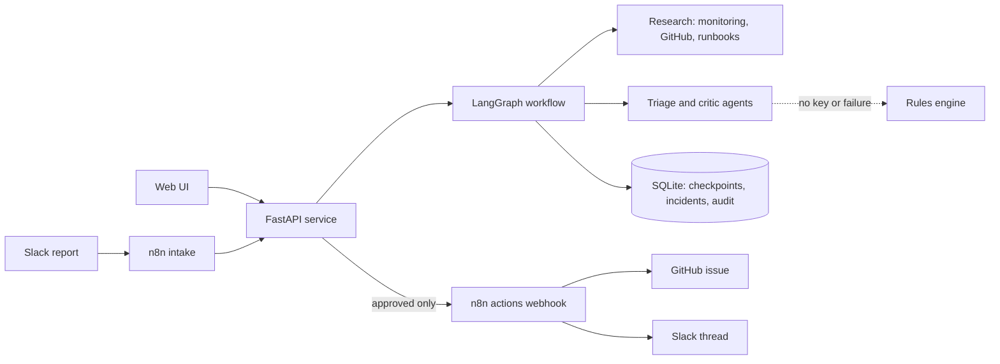
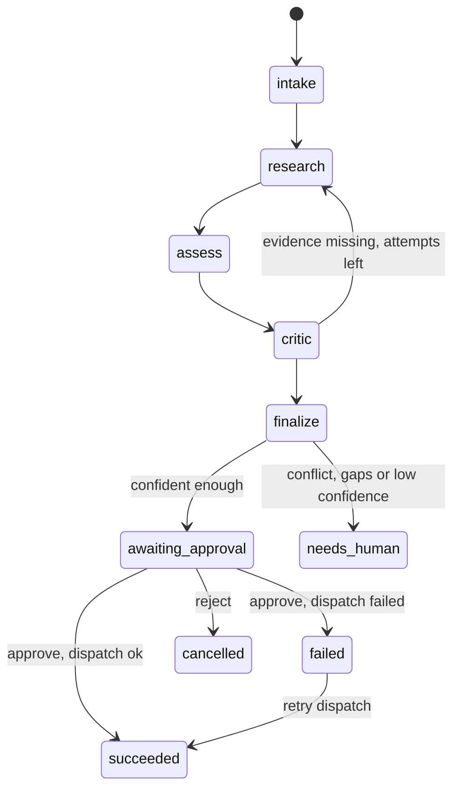

# IncidentOps Copilot

**An AI incident-triage assistant that never acts without a human saying yes.**

A teammate reports "checkout is throwing 5xx" in Slack. Copilot gathers the
evidence, finds the matching runbook, proposes a severity and a short list of
reversible actions, and waits. The incident commander reviews it in a web UI,
ticks the actions they want, and approves. Only then does
anything leave the building.

[](https://github.com/ft-kumarsatyam/incidentops-copilot/actions/workflows/ci.yml)


<table>
<tr>
<td width="66%"></td>
<td></td>
</tr>
</table>

## Try it in 60 seconds

No API keys, no Slack, no n8n. The offline rules engine runs everything.

```bash
git clone https://github.com/ft-kumarsatyam/incidentops-copilot.git
cd incidentops-copilot
make setup && make web-build && make dev
```

Open <http://localhost:8000>, click **Load a sample incident**, and watch the
pipeline run. Open the same page in a second tab and approve from there: the
first tab updates live.

Prefer Docker? `docker compose up --build` starts the API, the UI and n8n.

Prefer the terminal? `make demo` runs one incident end to end.

## Why this is different

| Most "AI agent" demos | IncidentOps Copilot |
|---|---|
| The model decides and acts | The model **proposes**; a person approves; n8n executes |
| Trusts whatever the model says | Every action must cite evidence or a runbook, checked **in code** |
| Needs an API key to run | Works fully offline; Claude is an upgrade, not a requirement |
| One failure and the run is lost | Durable runs survive restarts; failed dispatches are retryable |
| Double-click sends twice | Idempotent end to end: one approval, one ticket |
| Prompt injection is "out of scope" | Incident text is fenced and redacted, and the model cannot add actions outside a closed list |
| "It seems to work" | 10 labeled incidents scored on every pull request |

## What you get

| Area | Highlights |
|---|---|
| **Web UI** | Guided first run, live queue, pipeline stepper, evidence with runbook citations, per-action approval checklist, confirm dialog that states exactly what will be sent, light/dark themes, keyboard and mobile friendly |
| **AI layer** | Triage and critic agents with structured output, deterministic rules fallback, guardrails, confidence ceiling from missing facts, bounded critic loop |
| **Workflow** | LangGraph state machine with a SQLite checkpointer; approval is a real `interrupt()` and resume, not a re-run |
| **Reliability** | Idempotent start and decide, atomic run claiming, n8n dispatch retries with backoff, `failed` state with a retry button, append-only audit log |
| **Platform** | FastAPI, JSON logs with request and run IDs, optional OpenTelemetry, `/health` and `/ready`, rate limiting, CORS allowlist, body cap, fail-closed auth |
| **Integrations** | n8n workflow for Slack intake, a Slack summary that links to the review page, GitHub issue creation, shared-secret check and idempotency gate |
| **Quality** | 112 Python tests (94% coverage), 48 UI tests, mypy and ruff clean, eval suite, CI for backend, web and Docker |

## How it works



Python reasons. n8n holds the Slack and GitHub credentials and performs every
write. The service never stores those credentials.



The AI design, including what the model may and may not do, is in
[docs/AI_DESIGN.md](docs/AI_DESIGN.md).

## Quick start in detail

Requirements: Python 3.11+, Node 22+ (only to build the UI), and optionally
[uv](https://docs.astral.sh/uv/) for faster installs.

```bash
make setup        # virtualenv, dependencies, .env, web dependencies, git hooks
make web-build    # build the UI into the Python package (served at /)
make dev          # API on :8000 with reload, auth relaxed (INCIDENTOPS_ENV=dev)
make web-dev      # optional: UI hot reload on :5173, proxied to the API
```

Command line:

```bash
incidentops check                                   # verify configuration
incidentops incident --fixture tests/fixtures/incident_complete.json --approval approved
incidentops runbooks query "checkout 5xx after deploy"
```

Run `make help` for every target.

### Turn on Claude

Add your key to `.env` and restart. Nothing else changes.

```bash
ANTHROPIC_API_KEY=sk-ant-...
AI_PROVIDER=auto      # auto | claude | rules
```

With `auto`, any model error, timeout, or answer that fails validation falls
back to the rules engine and is recorded on the incident, so the run still
completes. `make eval-claude` scores Claude on the same labeled incidents.

## Configuration

Copy [.env.example](.env.example). The settings you will touch most:

| Variable | Default | Purpose |
|---|---|---|
| `INCIDENTOPS_ENV` | `dev` | Anything other than `dev` requires an API key (fail-closed) |
| `INCIDENTOPS_API_KEY` | | Sent as `X-API-Key`; paste it into **Settings** in the UI |
| `AI_PROVIDER` | `auto` | `auto`, `claude`, or `rules` |
| `ANTHROPIC_API_KEY` | | Enables Claude |
| `TRIAGE_MODEL` / `CRITIC_MODEL` | `claude-sonnet-5-5` / `claude-haiku-5-5` | Models per role |
| `CONFIDENCE_THRESHOLD` | `0.8` | Below this, the run goes to a human instead of approval |
| `MAX_RESEARCH_ATTEMPTS` | `2` | Bound on the critic-to-research loop |
| `ACTION_PROVIDER` | `n8n` | Approved-action dispatcher: `n8n` or `zapier` |
| `N8N_ACTION_WEBHOOK_URL` | | Where approved actions are sent |
| `N8N_ACTION_TOKEN` | | Shared secret n8n checks on that webhook |
| `ZAPIER_ACTION_WEBHOOK_URL` | | Webhooks by Zapier Catch Hook URL |
| `ZAPIER_ACTION_TOKEN` | | Optional token sent as `X-IncidentOps-Token` |
| `DATABASE_PATH` | `.data/incidentops.db` | Checkpoints, incident index, audit log |
| `CORS_ORIGINS` | `[]` | JSON list of allowed browser origins |

## Slack and n8n

1. Start the stack: `docker compose up --build`.
2. Import [n8n/incident-ops.json](n8n/incident-ops.json) into n8n.
3. Set the environment values listed in [n8n/README.md](n8n/README.md).
4. Point Slack events at `/webhook/incidentops/intake`.

The Slack message carries the proposal and a link to the incident page, where
the commander reviews the evidence and approves. Duplicate Slack deliveries and
double clicks are absorbed by idempotency keys on both sides.

To execute approved actions through Zapier instead, set
`ACTION_PROVIDER=zapier` and follow the
[Zapier adapter guide](zapier/README.md). The same human approval, retries, and
idempotency key apply.

## Evaluation

`make eval` scores 10 labeled incidents: severity, missing-field detection,
conflict detection, correct runbook, grounding, and safety (including a prompt
injection case). The offline rules baseline currently passes **10 of 10** and
runs in CI on every pull request. Full results are in
[evals/report.md](evals/report.md). `make eval-claude` runs the same suite
against Claude when you have a key.

`make eval-architecture` runs the same cases through an experimental parallel
impact/change/runbook specialist graph. It produced the same 10/10 quality,
safety, and grounding scores with more roles and higher latency, so Phase 4
**rejects a swarm and CrewAI for the current scope**. See
[the architecture report](evals/architecture_report.md) and
[ADR 006](docs/adr/006-reject-specialist-swarm-for-current-scope.md).

## Project structure

```text
src/incidentops/
  api/            FastAPI app factory, routes, auth, SSE, middleware
  agents/         Provider protocol, rules, Claude, guardrails, prompts
  workflows/      LangGraph state, nodes, graph, and the IncidentService
  persistence/    SQLite incident index and audit log
  tools/          Runbook search (FTS5), GitHub, monitoring, n8n client
  core/           Settings, logging, redaction, tracing, errors
web/              React + Vite + TypeScript UI (builds into the package)
evals/            Labeled incidents, scorers, runner, report
n8n/              Importable workflow and its setup notes
runbooks/         Markdown runbooks searched during research
tests/            Unit, workflow, API, agent and contract tests
docs/             Architecture, AI design, API, deployment, ADRs
```

## Documentation

| Read this | To learn |
|---|---|
| [Project brief](docs/PROJECT_BRIEF.md) | The two-page summary for engineering leaders: decisions, evidence, limits |
| [Architecture](docs/ARCHITECTURE.md) | Components, state, lifecycle, failure behavior |
| [AI design](docs/AI_DESIGN.md) | Agent roles, guardrails, evals, fallback |
| [API contract](docs/API_CONTRACT.md) | Endpoints, SSE, errors |
| [Deployment](docs/DEPLOYMENT.md) | Environments, secrets, scaling, backups |
| [Walkthrough](docs/WALKTHROUGH.md) | A guided tour with failure drills |
| [Decision records](docs/adr) | Why LangGraph, SQLite, provider fallback, SSE, React |
| [Security](SECURITY.md) | Threat model and reporting |
| [Demo script](docs/DEMO_SCRIPT.md) | A 90-second demo |
| [Contributing](CONTRIBUTING.md) | Setup, quality gates, how to extend |

## Measuring impact

```bash
python scripts/measure_impact.py --manual-minutes 20 --automated-minutes 4 --incidents 25
```

The script prints its assumptions with the result. The inputs are estimates:
replace them with pilot data before you make an impact claim.

## Status and roadmap

Suitable today for local use, demos, and a pilot behind your own network
controls. Known limits and the path forward:

- SQLite and the in-process event bus mean one API instance. For several
  instances, move to Postgres and a shared pub/sub ([DEPLOYMENT](docs/DEPLOYMENT.md)).
- Slack signature verification is not enforced in the template workflow yet.
- Claude results are not yet published; the eval harness is ready for them.
- Planned: Jira action node, per-user login, richer monitoring connectors.

## License

MIT. See [LICENSE](LICENSE).
