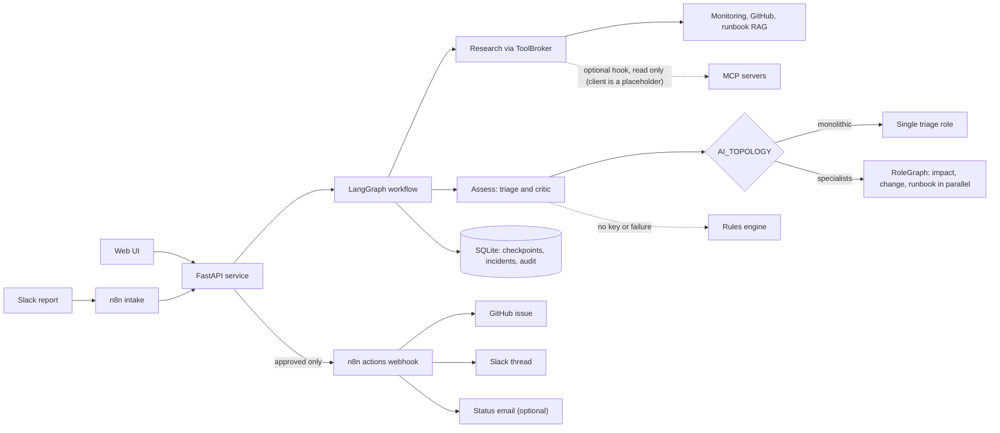
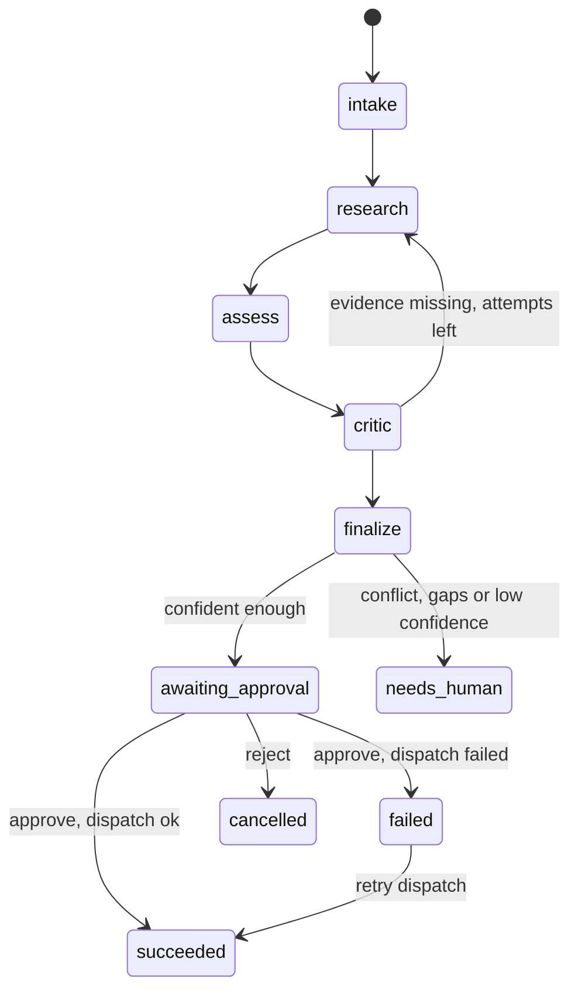

# IncidentOps Copilot

**An AI incident-triage assistant that never acts without a human saying yes.**

A teammate reports "checkout is throwing 5xx" in Slack. Copilot gathers the
evidence, finds the matching runbook, proposes a severity and a short list of
reversible actions, and waits. The incident commander reviews it in a web UI,
ticks the actions they want, and approves. Only then does
anything leave the building.

[](https://github.com/ft-kumarsatyam/incidentops-copilot/actions/workflows/ci.yml)


<table>
<tr>
<td width="66%"></td>
<td></td>
</tr>
</table>

## What is this, in plain words?

When something breaks (a website is down, payments fail, people can't log in),
the first 15 minutes are chaos. Someone has to work out **how bad it is**,
**what changed**, **which instructions apply**, and **what to do first**, while
messages pile up in chat.

IncidentOps Copilot does that first round of legwork for you:

1. **Listens.** Someone posts "checkout is throwing 5xx" in Slack (or you type
   it into the web page).
2. **Gathers evidence.** It looks at recent changes in GitHub and your
   monitoring data.
3. **Finds your playbook.** It searches your own written runbooks (plain
   Markdown files in [runbooks/](runbooks)) for the matching steps.
4. **Proposes a plan.** A severity, a short list of safe actions, and the
   evidence behind each one.
5. **Waits for you.** Nothing is sent, created, or changed until a person
   reads the plan, ticks the actions they agree with, and clicks approve.
6. **Tells people.** After approval, n8n opens the GitHub issue, replies in the
   Slack thread, and can send a status email.

It saves the "where do I even start?" time. It does not replace the person in
charge.

## Where you can use it in day-to-day life

You do not need to be a big company. Anywhere a small group gets pinged when
"something is broken" and follows the same steps each time, this fits.

| If you are... | A typical day looks like | What Copilot does for you |
|---|---|---|
| **A developer on a small team** | A deploy goes out and error alerts start | Spots that the errors began right after the deploy, finds your rollback steps, proposes "prepare a rollback" for you to approve |
| **On call for the week** | It is 2 a.m. and your phone buzzes | Hands you a ready summary with evidence instead of a blank page, so you decide in a minute rather than dig for twenty |
| **A team lead or incident commander** | Five people are asking "is this serious?" | Gives one severity call with reasons, flags what is still unknown, and keeps a record of who approved what |
| **Support or customer success** | A customer reports "I can't log in" | Anyone can file the report in plain language; it is turned into a structured incident with the right runbook attached |
| **A freelancer or agency running client sites** | A client's site or checkout stops working | Keeps your fix-it steps written down once and pulls up the right ones every time, even when you are away |
| **A new team member** | You have never handled an outage before | Shows the runbook steps and the reasoning, so you learn how your team responds while it happens |
| **A student or learner** | You want to understand AI agents that stay safe | Runs fully offline with no API key; read the code, the evals, and the design docs to see how "AI proposes, human approves" is built |

### A typical day with it

**Morning.** You write or update a runbook as a short Markdown file, for
example "what to do when the login service is slow". That is your team's
knowledge in one place.

**When something breaks.** A teammate posts in Slack. Copilot replies in the
thread with a proposed severity and actions, and a link to the incident page.

**Five minutes later.** You open the page, read the evidence, untick any action
you do not want, and approve. Only the approved actions go out: a GitHub issue
is created, a summary is posted back to the Slack thread, and a status email
is sent if you configured one.

**Afterwards.** The audit log shows exactly what was proposed, what you
approved, and when. Run `incidentops digest` for a read-only summary of the
last day's incidents to paste into your write-up or standup.

### What it is good at, and what it is not

| Good at | Not for |
|---|---|
| Triage and a first plan for software and service incidents | Fixing things by itself. It never acts without your approval |
| Making sure the same steps are followed every time | Replacing monitoring or alerting. It reads your data, it does not collect it |
| Working with no cloud AI at all (built-in rules engine) | Medical, legal, or safety-critical decisions |
| Keeping a clear record of every decision | Running on several servers at once yet. It is built for one instance today |

If your day-to-day "incident" is not software (a failed delivery, a broken
machine on a shop floor), the same pattern works: write your steps as runbooks,
point Copilot at them, and keep the approve step. You would need to adapt the
evidence sources, which today are GitHub and monitoring.

## Try it in 60 seconds

No API keys, no Slack, no n8n. The offline rules engine runs everything.

```bash
git clone https://github.com/ft-kumarsatyam/incidentops-copilot.git
cd incidentops-copilot
make setup && make web-build && make dev
```

Open <http://localhost:8000>, click **Load a sample incident**, and watch the
pipeline run. Open the same page in a second tab and approve from there: the
first tab updates live.

Prefer Docker? `docker compose up --build` starts the API, the UI and n8n.

Prefer the terminal? `make demo` runs one incident end to end.

## Why this is different

| Most "AI agent" demos | IncidentOps Copilot |
|---|---|
| The model decides and acts | The model **proposes**; a person approves; n8n executes |
| Trusts whatever the model says | Every action must cite evidence or a runbook, checked **in code** |
| Needs an API key to run | Works fully offline; Claude is an upgrade, not a requirement |
| One failure and the run is lost | Durable runs survive restarts; failed dispatches are retryable |
| Double-click sends twice | Idempotent end to end: one approval, one ticket |
| Prompt injection is "out of scope" | Incident text is fenced and redacted, and the model cannot add actions outside a closed list |
| More agents means better | Parallel specialists are built, **measured against the single-agent baseline**, and stay opt-in until they earn a promotion |
| "It seems to work" | 37 labeled incidents, 152 hostile outputs and 11 retrieval queries scored on every pull request |

## What you get

| Area | Highlights |
|---|---|
| **Web UI** | Guided first run, live queue, pipeline stepper (shows parallel roles when enabled), evidence with runbook citations, per-action approval checklist, confirm dialog that states exactly what will be sent, a Settings page that shows the server's AI topology and MCP status, light/dark themes, keyboard and mobile friendly |
| **AI layer** | Triage and critic agents with structured output, deterministic rules fallback, guardrails, confidence ceiling from missing facts, bounded critic loop |
| **RoleGraph** | Optional `AI_TOPOLOGY=specialists`: impact, change and runbook roles run in parallel inside `assess`, merge deterministically, and pass the same guardrails. Default stays `monolithic` ([orchestration guide](docs/ORCHESTRATION.md)) |
| **Workflow** | LangGraph state machine with a SQLite checkpointer; approval is a real `interrupt()` and resume, not a re-run |
| **Reliability** | Idempotent start and decide, atomic run claiming, n8n dispatch retries with backoff, `failed` state with a retry button, append-only audit log |
| **Platform** | FastAPI, JSON logs with request and run IDs, optional OpenTelemetry, `/health` and `/ready` (reports topology and MCP state), rate limiting, CORS allowlist, body cap, fail-closed auth |
| **Integrations** | n8n workflow for Slack intake, Slack summary with a link to the review page, GitHub issue creation, optional email status after approval, shared-secret check and idempotency gate; Zapier as an alternative dispatcher ([integrations guide](docs/INTEGRATIONS.md)) |
| **MCP (optional, early)** | A read-only hook in the research step (via `ToolBroker`) is wired in and off by default. It is non-fatal on failure and has no write path. The external MCP client is still a placeholder, so today it records that the bridge was attached and does not query servers yet |
| **RAG** | Dedicated `rag/` package: FTS5 + deterministic query rewrite; optional hybrid embeddings; [labeled retrieval evals](evals/retrieval_report.md) ([design doc](docs/RAG_SYSTEM_DESIGN.md)) |
| **CLI** | `incidentops check`, `incident`, `runbooks index/query`, and `digest` for a read-only summary of recent incidents |
| **Quality** | 381 Python tests (88% coverage, gate at 85%), 48 UI tests, mypy clean, four eval suites (incident, guardrails, retrieval, architecture), CI |

## How it works



Python reasons. n8n holds the Slack, GitHub and email credentials and performs
every write. The service never stores those credentials.



LangGraph owns the outer incident graph and the human `interrupt()`. RoleGraph
only decides how many reasoning roles run inside `assess`. See
[docs/AI_SYSTEM_DESIGN.md](docs/AI_SYSTEM_DESIGN.md) for the five planes and
flows, and [docs/AI_DESIGN.md](docs/AI_DESIGN.md) for what the model may and
may not do.

## Quick start in detail

Requirements: Python 3.11+, Node 22+ (only to build the UI), and optionally
[uv](https://docs.astral.sh/uv/) for faster installs.

```bash
make setup        # virtualenv, dependencies, .env, web dependencies, git hooks
make web-build    # build the UI into the Python package (served at /)
make dev          # API on :8000 with reload, auth relaxed (INCIDENTOPS_ENV=dev)
make web-dev      # optional: UI hot reload on :5173, proxied to the API
```

Command line:

```bash
incidentops check                                   # verify configuration
incidentops incident --fixture tests/fixtures/incident_complete.json --approval approved
incidentops runbooks query "checkout 5xx after deploy"
incidentops digest --hours 24                       # read-only summary of recent incidents
```

Run `make help` for every target. `make check` runs lint, typecheck, tests with
coverage, the evals and the web tests. `make e2e-smoke` runs the demo fixture
and asserts the timeline.

### Turn on Claude

Add your key to `.env` and restart. Nothing else changes.

```bash
ANTHROPIC_API_KEY=sk-ant-...
AI_PROVIDER=auto      # auto | claude | rules
```

With `auto`, any model error, timeout, or answer that fails validation falls
back to the rules engine and is recorded on the incident, so the run still
completes. `make eval-claude` scores Claude on the same labeled incidents.

### Try parallel specialists

```bash
AI_TOPOLOGY=specialists AI_PROVIDER=rules make demo   # free, offline
AI_TOPOLOGY=specialists AI_PROVIDER=claude make dev   # LLM roles, needs a key
```

The incident page then labels the triage step with the number of parallel
roles, and each role's provider and tokens are recorded on the incident. The
default stays `monolithic` until `make eval-architecture` shows a gain that
clears the adoption gate (see [Evaluation](#evaluation)).

### Add read-only MCP context

```bash
pip install -e '.[mcp]'
MCP_ENABLED=true
MCP_SERVERS='[{"name":"slack","command":"..."}]'
```

[.mcp.json.example](.mcp.json.example) shows the shape for local, IDE-style
servers. MCP is read only by design and a failing server never fails the run.

**Current state:** the hook, the settings and the safety boundary are in place,
but `tools/mcp/client.py` is a placeholder. With `MCP_ENABLED=true` the run
records an `mcp:<name>` marker in the evidence and timeline; it does not yet
call the servers you list. Implementing that client is the next step. Details
in [docs/INTEGRATIONS.md](docs/INTEGRATIONS.md).

## Configuration

Copy [.env.example](.env.example). The settings you will touch most:

| Variable | Default | Purpose |
|---|---|---|
| `INCIDENTOPS_ENV` | `dev` | Anything other than `dev` requires an API key (fail-closed) |
| `INCIDENTOPS_API_KEY` | | Sent as `X-API-Key`; paste it into **Settings** in the UI |
| `INCIDENTOPS_PUBLIC_URL` | `http://localhost:8000` | The review-page link people get in Slack |
| `AI_PROVIDER` | `auto` | `auto`, `claude`, or `rules` |
| `AI_TOPOLOGY` | `monolithic` | `monolithic`, or `specialists` for parallel RoleGraph roles |
| `ANTHROPIC_API_KEY` | | Enables Claude |
| `TRIAGE_MODEL` / `CRITIC_MODEL` | `claude-sonnet-5-5` / `claude-haiku-5-5` | Models per role |
| `SPECIALIST_MODEL` | | Model for specialist roles (falls back to the triage model) |
| `ROLEGRAPH_MAX_PARALLEL` | `4` | Today this caps how many `MCP_SERVERS` are attached per run |
| `MCP_ENABLED` / `MCP_SERVERS` | `false` / `[]` | Optional read-only MCP hook (needs the `[mcp]` extra; client still a placeholder) |
| `RUNBOOK_RETRIEVAL` | `fts` | `fts` or `hybrid` (hybrid needs the `[rag]` extra and a reindex) |
| `CONFIDENCE_THRESHOLD` | `0.8` | Below this, the run goes to a human instead of approval |
| `MAX_RESEARCH_ATTEMPTS` | `2` | Bound on the critic-to-research loop |
| `ACTION_PROVIDER` | `n8n` | Approved-action dispatcher: `n8n` or `zapier` |
| `N8N_ACTION_WEBHOOK_URL` | | Where approved actions are sent |
| `N8N_ACTION_TOKEN` | | Shared secret n8n checks on that webhook |
| `ZAPIER_ACTION_WEBHOOK_URL` | | Webhooks by Zapier Catch Hook URL |
| `ZAPIER_ACTION_TOKEN` | | Optional token sent as `X-IncidentOps-Token` |
| `DATABASE_PATH` | `.data/incidentops.db` | Checkpoints, incident index, audit log |
| `CORS_ORIGINS` | `[]` | JSON list of allowed browser origins |

`NOTIFY_EMAIL_TO` and `NOTIFY_FROM_EMAIL` are read by n8n, not by the Python
service. See [n8n/README.md](n8n/README.md).

## Slack, email and n8n

1. Start the stack: `docker compose up --build`.
2. Import [n8n/incident-ops.json](n8n/incident-ops.json) into n8n.
3. Set the environment values listed in [n8n/README.md](n8n/README.md).
4. Point Slack events at `/webhook/incidentops/intake`.
5. Optional: set `NOTIFY_EMAIL_TO` (and configure SMTP in n8n) to get a status
   email after each approval. If it is empty, the email step is skipped.

The Slack message carries the proposal and a link to the incident page, where
the commander reviews the evidence and approves. Duplicate Slack deliveries and
double clicks are absorbed by idempotency keys on both sides. To open incidents
from email as well, see the intake template in
[docs/INTEGRATIONS.md](docs/INTEGRATIONS.md).

To execute approved actions through Zapier instead, set
`ACTION_PROVIDER=zapier` and follow the
[Zapier adapter guide](zapier/README.md). The same human approval, retries, and
idempotency key apply.

## Evaluation

Every number below is reproducible with one command and runs in CI.

| Suite | Command | Result |
|---|---|---|
| Incidents | `make eval` | **37 of 37** pass: 10 core cases plus 27 edge cases covering severity, missing facts, conflicts, runbook choice, grounding, safety and prompt injection ([report](evals/report.md)) |
| Guardrails | `make eval-guardrails` | **152 of 152** hostile outputs blocked, **29 of 29** benign outputs kept ([report](evals/guardrail_report.md)) |
| Retrieval | `make eval-retrieval` | Recall@k: raw FTS 81.8%, with query rewrite **100%**, hybrid 100% ([report](evals/retrieval_report.md)) |
| Architecture | `make eval-architecture` | Single-agent graph vs parallel specialists ([report](evals/architecture_report.md)) |

`make eval-claude` runs the incident suite against Claude when you have a key.

**Specialists vs the baseline.** On the offline rules path, the parallel
specialists score the same 100% on quality, safety and grounding as the
single-agent graph, with more roles and a little more latency. The adoption
gate is at least 5 percentage points of case-pass improvement with no safety
regression, so the specialist topology **stays opt-in** and the default is
unchanged. See [ADR 006](docs/adr/006-reject-specialist-swarm-for-current-scope.md),
[ADR 008](docs/adr/008-llm-specialists-and-mcp.md) and
[ADR 009](docs/adr/009-rolegraph-on-langgraph.md).

## Project structure

```text
src/incidentops/
  api/            FastAPI app factory, routes, auth, SSE, middleware
  agents/         Provider protocol, rules, Claude, LLM roles, guardrails, prompts
  orchestration/  RoleGraph: parallel roles, merge, topology registry, provenance
  workflows/      LangGraph state, nodes, graph, and the IncidentService
  rag/            Runbook RAG: FTS index, query rewrite, hybrid rerank, retriever API
  tools/          ToolBroker, GitHub, monitoring, n8n, Zapier; mcp/ read-only bridge
  persistence/    SQLite incident index and audit log
  core/           Settings, logging, redaction, tracing, errors
web/              React + Vite + TypeScript UI (builds into the package)
evals/            Incident, guardrail, retrieval, and architecture benchmarks
n8n/              Importable workflow and its setup notes
zapier/           Alternative action dispatcher and example payload
runbooks/         Markdown corpus indexed by rag/
tests/            Unit, workflow, API, agent, orchestration and contract tests
docs/             Architecture, AI system design, RAG, integrations, ADRs
```

Full map: [docs/REPOSITORY_MAP.md](docs/REPOSITORY_MAP.md).

## For reviewers (portfolio)

Short path for interviews and hiring managers:
[docs/PORTFOLIO.md](docs/PORTFOLIO.md). Reproduce every quality number with
`make check`.

| Report | Command |
|---|---|
| [evals/report.md](evals/report.md) | `make eval` |
| [evals/guardrail_report.md](evals/guardrail_report.md) | `make eval-guardrails` |
| [evals/retrieval_report.md](evals/retrieval_report.md) | `make eval-retrieval` |
| [evals/architecture_report.md](evals/architecture_report.md) | `make eval-architecture` |
| [evals/report-claude.md](evals/report-claude.md) | `make eval-claude` (needs an API key) |

## Documentation

| Read this | To learn |
|---|---|
| [AI system design](docs/AI_SYSTEM_DESIGN.md) | Five planes, flows, RoleGraph, MCP bridge |
| [Orchestration](docs/ORCHESTRATION.md) | RoleGraph on LangGraph, and how to add a role |
| [Integrations](docs/INTEGRATIONS.md) | Slack, email, n8n, MCP |
| [Portfolio guide](docs/PORTFOLIO.md) | Demo script, talking points, evidence tables |
| [RAG system design](docs/RAG_SYSTEM_DESIGN.md) | Chunking, rewrite, hybrid, eval metrics |
| [Repository map](docs/REPOSITORY_MAP.md) | Where every package and eval suite lives |
| [Eval suites](evals/README.md) | How incident, retrieval, and guardrail benchmarks work |
| [Project brief](docs/PROJECT_BRIEF.md) | The two-page summary for engineering leaders |
| [Architecture](docs/ARCHITECTURE.md) | Components, state, lifecycle, failure behavior |
| [AI design](docs/AI_DESIGN.md) | Guardrails, evals, fallback (detail) |
| [Guardrails](docs/GUARDRAILS.md) | The safety layer matrix |
| [API contract](docs/API_CONTRACT.md) | Endpoints, SSE, errors |
| [Deployment](docs/DEPLOYMENT.md) | Environments, secrets, scaling, backups |
| [Walkthrough](docs/WALKTHROUGH.md) | A guided tour with failure drills |
| [Decision records](docs/adr) | Why LangGraph, SQLite, fallback, SSE, React, RoleGraph, MCP |
| [Security](SECURITY.md) | Threat model and reporting |
| [Demo script](docs/DEMO_SCRIPT.md) | A 90-second demo |
| [Contributing](CONTRIBUTING.md) | Setup, quality gates, how to extend |

## Measuring impact

```bash
python scripts/measure_impact.py --manual-minutes 20 --automated-minutes 4 --incidents 25
```

The script prints its assumptions with the result. The inputs are estimates:
replace them with pilot data before you make an impact claim.

## Status and roadmap

Suitable today for local use, demos, and a pilot behind your own network
controls. Known limits and the path forward:

- SQLite and the in-process event bus mean one API instance. For several
  instances, move to Postgres and a shared pub/sub ([DEPLOYMENT](docs/DEPLOYMENT.md)).
- Slack signature verification is not enforced in the template workflow yet.
- Specialist roles with a real model are not yet scored against the baseline:
  run `AI_TOPOLOGY=specialists AI_PROVIDER=claude make eval-architecture` with a key.
- Claude comparison on the core cases: run `make eval-claude` when you have a key
  ([evals/report-claude.md](evals/report-claude.md)).
- The MCP client is a placeholder (see above); email intake is a documented
  n8n template, not a shipped branch.
- Planned: Jira action node, per-user login, richer monitoring connectors.

## License

MIT. See [LICENSE](LICENSE).
