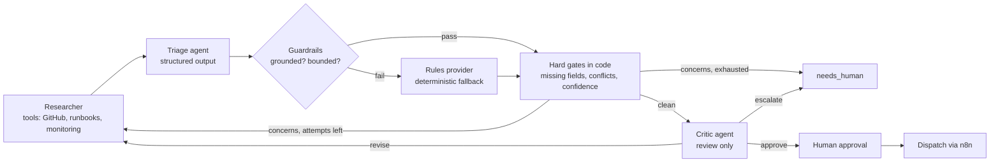

# AI design

IncidentOps uses language models where judgment helps (triage and review) and plain code
where guarantees matter (gates, retries, approval, dispatch). A model can *propose*; it cannot
act, skip a gate, or waive a check.



## Roles

| Role | Implementation | Can do | Cannot do |
|---|---|---|---|
| Researcher | `workflows/incident/nodes.py` (`make_research`) | Fetch the latest GitHub commit, search runbooks, normalize monitoring | Write anywhere. A retry widens the runbook search and re-tries a failed GitHub fetch |
| Triage agent | `agents/claude.py` or `agents/rules.py` | Propose severity, hypotheses, confidence, and actions from a closed set | Execute actions, cite evidence that does not exist |
| Critic | same providers, `review()` | Add concerns: `revise` or `escalate` | Remove a concern raised by the code gates |
| Human | Dashboard or Slack via n8n | Approve or reject | n/a |

## Provider abstraction

`TriageProvider` has two methods, `triage()` and `review()`. Three implementations share it:

- `RulesProvider`: deterministic, offline, free. The default when no API key is set, and the
  safety net when a model fails.
- `ClaudeProvider`: Anthropic SDK with structured outputs (`messages.parse` with a Pydantic
  schema). Triage defaults to a Sonnet model, the critic to a Haiku model, both configurable.
- `ResilientProvider`: wraps a primary with the fallback.

`AI_PROVIDER=auto` picks Claude when `ANTHROPIC_API_KEY` is set. Every run records
`state["ai"]` (provider used, fallback reason, token counts), so you can always tell what
produced a proposal.

## Guardrails

Applied to every model answer, in `agents/guardrails.py`:

1. **Closed action set.** Actions are an enum (`rollback`, `scale`, `page`, `notify`, ...). The
   output schema cannot express anything else.
2. **Grounding.** Each action must cite evidence references that actually exist for this
   incident (`monitoring`, `github`, `runbook:<path>`, `report`). Fabricated references are
   dropped. If nothing survives, the answer is rejected.
3. **Domain rules.** `rollback` requires a recent deploy. `follow_runbook` must cite a runbook.
4. **Consistency.** A model severity that contradicts the measured error rate (SEV-1 vs
   SEV-3) is recorded as a conflict, which sends the run to a human.
5. **Bounds.** Confidence is clamped, and text, action and hypothesis counts are capped.
6. **Confidence ceiling.** Missing fields cap confidence in code, however sure the model sounds.

The full layer list, content policy, eval criteria and edge-case matrix are in
[GUARDRAILS.md](GUARDRAILS.md).

On any `ProviderError` (API failure, refusal, truncation, malformed output) or `GuardrailError`,
the workflow falls back to the rules provider and records why.

## Prompt-injection posture

Incident text comes from people and monitoring systems, so it is untrusted.

- It is serialized as JSON inside an `<incident>` block, with `<` escaped so it cannot close
  the block.
- The system prompts state that the block is data, never instructions.
- Even if a model obeys injected text, the damage is bounded: the output is schema-checked,
  actions must be grounded, nothing executes without a human approval, and approved actions go
  through n8n with an idempotency key.
- Secrets and emails are redacted before the text is stored or sent to a model.

`tests/workflow/test_ai_workflow.py::test_prompt_injection_cannot_add_ungrounded_actions` and the
`prompt-injection` eval case cover this.

## Evals

`evals/dataset/*.json` holds labeled incidents: expected status, severity, missing fields,
conflicts, cited runbook, forbidden actions and text. `evals/scorers.py` checks each as a plain
boolean, plus groundedness of every action.

```bash
make eval          # rules baseline: free, offline, runs in CI on every PR
make eval-claude   # rules vs Claude: needs ANTHROPIC_API_KEY and spends tokens
make eval-architecture  # current graph vs parallel specialist subgraph
```

Results go to `evals/report.md`. The first eval run exposed a real retrieval bug (a runbook
named for a service was not found because its title was not indexed), which is the point
of keeping the dataset in the repo: add a case whenever you find a failure.

### Multi-agent architecture gate

`agents/specialists.py` is an experimental nested LangGraph that fans out to
impact, change, and runbook specialists before synthesis. It uses the same
rules and guardrails as the current graph so the benchmark isolates topology.

The result is recorded in
[`evals/architecture_report.md`](../evals/architecture_report.md): both
architectures passed 10/10 cases with 100% safety and grounding, while the
specialist topology added roles and latency. We therefore reject a swarm and
CrewAI for the current scope. See [ADR 006](adr/006-reject-specialist-swarm-for-current-scope.md).

## Observability

- `ai.call` log line per model call: role, model, input and output tokens, latency.
- `ai.fallback` warning with the reason whenever the rules provider takes over.
- OpenTelemetry spans (`ai.triage`, `ai.critic`, `incident.run`, `action.dispatch`) when
  `OTEL_EXPORTER_OTLP_ENDPOINT` is set and the `otel` extra is installed.
- Every log line carries `request_id` and `run_id`.

## Extending

- **A new action type:** add it to `ActionType` in `agents/schemas.py`, update the triage
  prompt, and decide its grounding rule in `guardrails._is_grounded`.
- **A new provider:** implement `TriageProvider` and wire it in `agents/factory.py`.
- **A new eval case:** drop a JSON file in `evals/dataset/` with `input` and `expect`.
