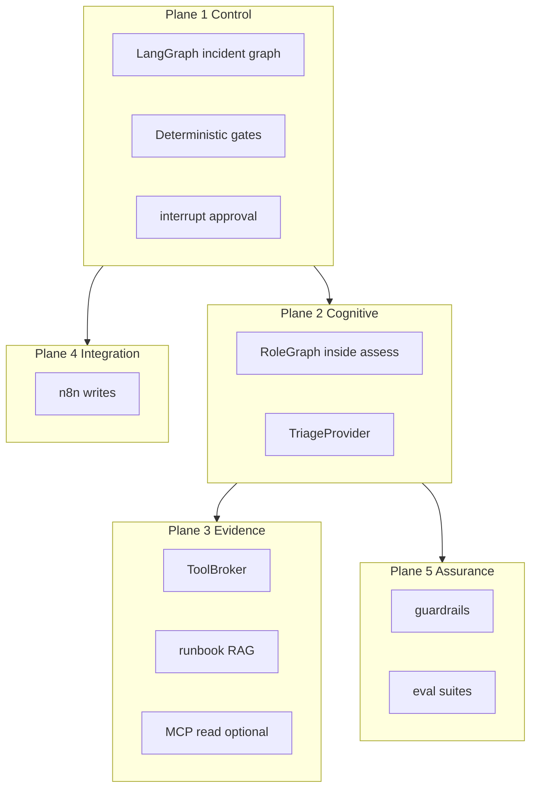
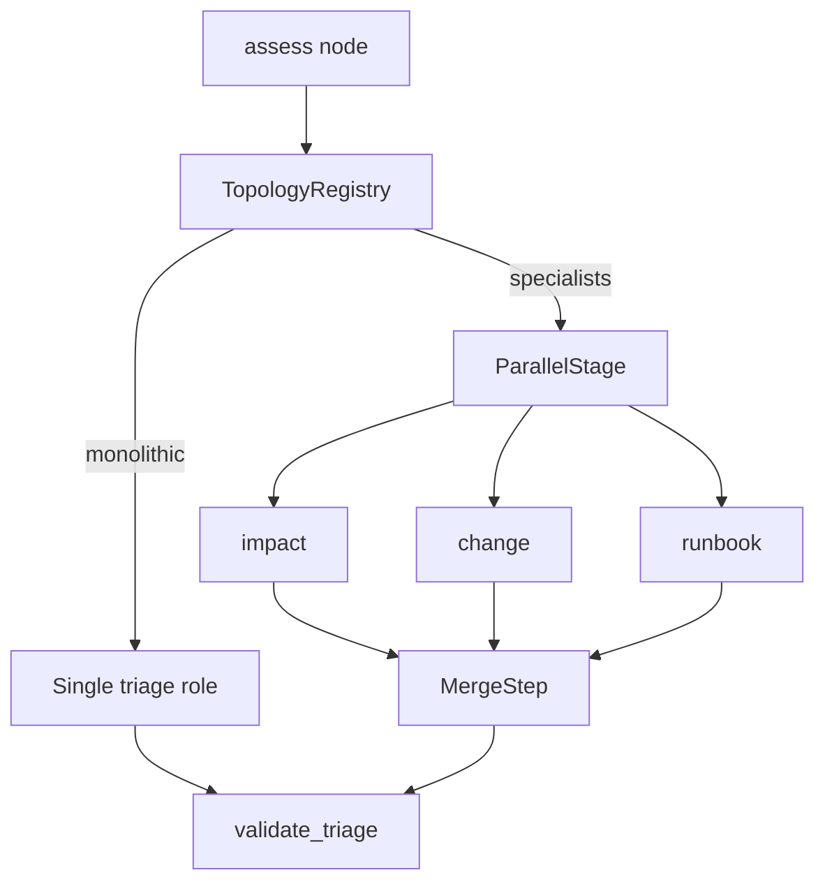
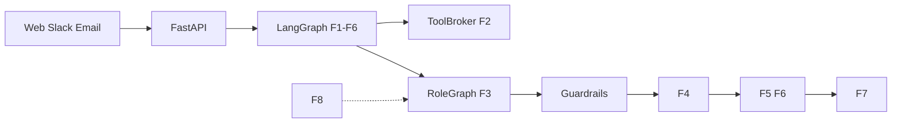

# AI system design

Canonical architecture for IncidentOps Copilot: layers, flows, contracts, and how
multi-agent cognition sits on LangGraph. Operators and reviewers should start here;
depth lives in linked docs.

## Invariant

**Propose → human approve → n8n execute.** No model or tool path writes to Slack,
GitHub, email, or ticketing without an explicit human approval and dispatch.

## Documentation map

| Document | Scope |
|---|---|
| **This file** | Five planes, flows F1–F9, RoleGraph, config |
| [ORCHESTRATION.md](ORCHESTRATION.md) | RoleGraph developer guide |
| [INTEGRATIONS.md](INTEGRATIONS.md) | Slack, email, n8n, MCP setup |
| [AI_DESIGN.md](AI_DESIGN.md) | Guardrails, evals, prompt posture (detail) |
| [ARCHITECTURE.md](ARCHITECTURE.md) | Runtime, persistence, API, lifecycle |
| [GUARDRAILS.md](GUARDRAILS.md) | Safety layer matrix |
| [adr/](adr/) | Irreversible decisions and adoption gates |

## Five planes



| Plane | Owns | Must not |
|---|---|---|
| 1 Control | State machine, retries, confidence gates, critic loop, `interrupt()` | OAuth for writes |
| 2 Cognitive | Triage/critic, topology (`monolithic` \| `specialists`) | Execute actions |
| 3 Evidence | Monitoring, GitHub, RAG, optional MCP **read** | Autonomous writes |
| 4 Integration | Dispatch after approval | Reasoning |
| 5 Assurance | `validate_triage`, redaction, evals, ADRs | Ad hoc branching |

## RoleGraph (framework on LangGraph)

LangGraph owns the **outer** incident graph ([ADR 001](adr/001-langgraph-as-orchestrator.md)).
**RoleGraph** (`src/incidentops/orchestration/`) owns the **inner** cognitive topology
inside the `assess` node only. See [ORCHESTRATION.md](ORCHESTRATION.md) and
[ADR 009](adr/009-rolegraph-on-langgraph.md).



Every topology returns a `Triage` through the same guardrails and `ResilientProvider`
fallback ([ADR 003](adr/003-provider-fallback.md)).

## Flow catalog

### F1 — Intake

Slack/web/email (optional) → API `POST /incidents` → redact → `IncidentService.start` →
`intake` node → durable `run_id` in SQLite checkpoint.

### F2 — Research

`research` node → `ToolBroker.retrieve_evidence` → monitoring, GitHub, runbook RAG,
optional MCP read context (non-fatal on failure). Retries widen runbook query.

Evidence citation keys: `report`, `monitoring`, `github`, `runbook:<path>`, `mcp:<server>`.

### F3 — Assess

`TriageProvider.triage(TriageContext)`:

| Topology | Behavior |
|---|---|
| `monolithic` | One triage call (Claude or rules) |
| `specialists` | Parallel roles → merge → optional LLM synthesizer |

Provenance: `state["ai"]` includes `topology`, `roles[]` (per-role provider, tokens).

### F4 — Critic loop

Code gates first; model critic only when gates pass. `revise` → research if
`retries < max_research_attempts`; else `needs_human`.

### F5 — Finalize

Confidence ceiling from missing fields, conflicts → `awaiting_approval` or `needs_human`.

### F6 — Human decision

Web UI → `POST .../decide` → `Command(resume=...)` → same thread, no replay from intake.

### F7 — Dispatch

Approved actions only → n8n/Zapier webhook → GitHub issue, Slack thread, optional email.

### F8 — Quality feedback

`make eval`, `make eval-guardrails`, `make eval-architecture` → adoption gate
(≥5pp case-pass for topology change, no safety regression). See
[evals/architecture_report.md](../evals/architecture_report.md), [ADR 006](adr/006-reject-specialist-swarm-for-current-scope.md),
[ADR 008](adr/008-llm-specialists-and-mcp.md).

### F9 — Daily digest

`incidentops digest --hours 24` — read-only summary; optional n8n schedule to Slack/email.

## Configuration

| Variable | Plane | Effect |
|---|---|---|
| `AI_PROVIDER` | 2 | `auto` \| `rules` \| `claude` |
| `AI_TOPOLOGY` | 2 | `monolithic` (default) \| `specialists` |
| `SPECIALIST_MODEL` | 2 | Model for specialist roles when using Claude |
| `MCP_ENABLED` | 3 | Enable MCP bridge in research |
| `MCP_SERVERS` | 3 | JSON list of server descriptors (optional) |
| `RUNBOOK_RETRIEVAL` | 3 | `fts` \| `hybrid` |
| `MAX_RESEARCH_ATTEMPTS` | 1 | Critic/research bound |
| `CONFIDENCE_THRESHOLD` | 1 | Finalize gate |
| `N8N_*` / `ACTION_PROVIDER` | 4 | Dispatch |

## Repository layout (planes)

```text
workflows/       Plane 1 — LangGraph + IncidentService
orchestration/   Plane 1+2 — RoleGraph
agents/          Plane 2 — providers, prompts, guardrails
tools/ + tools/mcp/  Plane 3 — ToolBroker, MCP bridge
rag/             Plane 3 — runbook index and retrieval
api/             Plane 4 entry
persistence/     checkpoints + read model
evals/           Plane 5
n8n/             Plane 4 writes
```

## End-to-end

