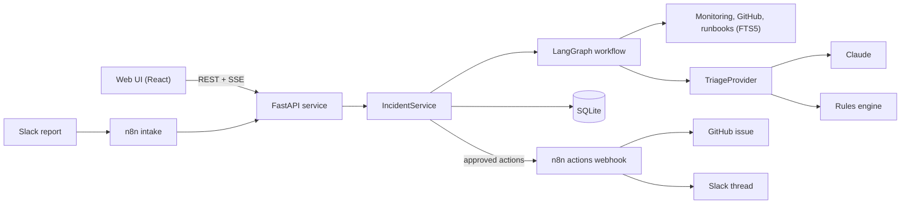
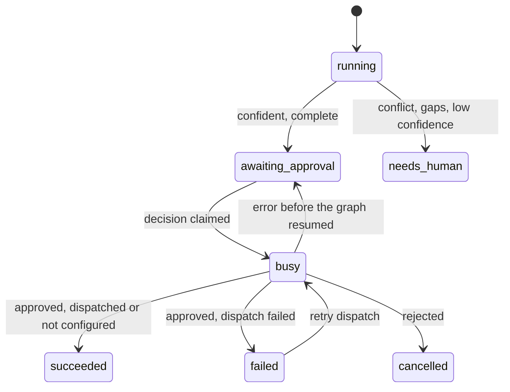
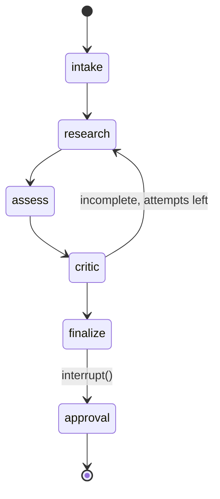

# Architecture

IncidentOps Copilot turns a vague incident report into a reviewed, evidence-backed
proposal and waits for a human decision before anything is written to an
outside system.

## Design principles

1. **The model proposes, a person approves, n8n executes.** No code path lets a
   model call an external write.
2. **Validate in code, not in the prompt.** Guardrails run after the model and
   cannot be talked out of anything.
3. **Offline first.** The rules engine is a complete implementation. Claude is
   an upgrade that can fail without failing the incident.
4. **Durable by default.** A run is a LangGraph thread in SQLite. Restarting the
   process loses nothing.
5. **Every transition is safe to repeat.** Starting, deciding and dispatching
   are idempotent, and concurrent callers are serialized by an atomic claim.

## System context



Python never holds Slack or Jira credentials. It sends a bearer-token
request to n8n, which owns the integrations.

## Components

| Component | Where | Responsibility |
|---|---|---|
| HTTP layer | `src/incidentops/api/` | Routing, auth, validation, SSE, request IDs, rate limit, body cap, error mapping |
| Application service | `workflows/incident/service.py` | `start`, `decide`, `retry_dispatch`, `search`, audit, event publishing |
| Workflow | `workflows/incident/{state,nodes,graph}.py` | The state machine and its nodes |
| AI layer | `src/incidentops/agents/` | Provider protocol, Claude and rules providers, guardrails, prompts |
| RoleGraph | `src/incidentops/orchestration/` | Cognitive topology inside `assess` (see [AI_SYSTEM_DESIGN.md](AI_SYSTEM_DESIGN.md)) |
| Tool broker | `src/incidentops/tools/broker.py` | Unified research evidence + optional MCP read |
| Persistence | `persistence/repo.py`, LangGraph `SqliteSaver` | Checkpoints, queryable incident index, append-only audit log |
| Tools | `src/incidentops/tools/` | Runbook search, GitHub context, monitoring, n8n client with retries |
| Core | `src/incidentops/core/` | Settings, structured logging, redaction, tracing, domain errors |
| Web UI | `web/` | Dashboard, incident page, approval flow, settings |

## State and storage

`IncidentState` is a JSON-serializable `TypedDict`. `timeline` uses an
append reducer, so each node adds entries instead of replacing them.

```text
identity   run_id, idempotency_key, channel_id, thread_ts
facts      summary, service, owner, reporter, symptoms
evidence   monitoring and GitHub payloads, runbook_hits
decision   severity, confidence, hypotheses, action_items, proposed_actions,
           missing_fields, conflicts
review     ai (provider, fallback reason), ai_review (critic concerns)
control    retries, approval, approved_actions, action_dispatch, status, timeline
```

Two stores share one SQLite file:

- **Checkpoints** (LangGraph `SqliteSaver`) are the source of truth for workflow
  state, keyed by `thread_id = run_id`.
- **`incidents` and `audit_log` tables** are a read model for listing and
  search, plus an append-only record of who did what and when.

## Lifecycle



`busy` is a transient status held only while a decision or retry is in flight.
It is the lock: `claim(run_id, expected)` flips the status atomically, so two
simultaneous approvals cannot both proceed.

## The workflow



| Node | Contract |
|---|---|
| `intake` | Normalize the payload (the service has already redacted secrets and emails) and record which required facts are missing |
| `research` | Merge monitoring and GitHub evidence, retrieve cited runbook sections, widen the query on a retry |
| `assess` | Ask the provider for severity, confidence, hypotheses and actions, then run guardrails |
| `critic` | Review the proposal against the evidence, add concerns, decide whether to loop (bounded by `MAX_RESEARCH_ATTEMPTS`) |
| `finalize` | Choose `awaiting_approval` or `needs_human`, then pause on `interrupt()` when approval is needed |

Approval is a real LangGraph interrupt. A decision resumes the same thread with
`Command(resume={"decision": ..., "approved_actions": [...]})`. Nothing is
re-run from the start, so the timeline and evidence are preserved.

Full detail on the provider, guardrails and evals is in [AI_DESIGN.md](AI_DESIGN.md).

## Deciding, step by step

1. The caller posts `{idempotency_key, decision, approved_actions?}`.
2. The key must match the run, and `approved_actions` must be a subset of the
   proposal, otherwise `409`.
3. The service claims the run from `awaiting_approval`. If it cannot, the run
   was already decided and the caller gets `409`.
4. The graph resumes. The audit log records the decision and the actor.
5. On approval, the service dispatches the chosen actions to n8n with retry and
   backoff, then records `sent`, `not_configured` or `failed`.
6. A failed dispatch sets the run to `failed`. `POST /retry-dispatch` sends the
   same payload again, and n8n's idempotency gate prevents a duplicate ticket.
7. Every change is published on the event bus, which feeds the SSE stream.

## Live updates

The service publishes an event whenever a run changes. `GET /incidents/stream`
relays them as Server-Sent Events. The UI uses a fetch-based reader (so it can
send `X-API-Key`), reconnects on drop, and falls back to polling every 15
seconds. The bus is in-process. See
[ADR 004](adr/004-sse-over-websocket.md) and [DEPLOYMENT.md](DEPLOYMENT.md) for
running more than one instance.

## Runbook retrieval

`incidentops runbooks index` chunks Markdown by heading into an SQLite FTS5
table. Research expands the query with deterministic service aliases, searches
with the service, summary and symptoms, and prefers the runbook that matches the
service. Hits keep their path, section title, excerpt and rank, and proposed
actions cite them. FTS5 is the default backend; optional hybrid mode stores local
embeddings in the same SQLite file and reranks FTS candidates
(`RUNBOOK_RETRIEVAL=hybrid`, `[rag]` extra). See [ADR 007](adr/007-hybrid-runbook-retrieval.md)
and `make eval-retrieval`.

## Failure behavior

| Failure | Result |
|---|---|
| Missing service or summary | Retry research, then `needs_human` listing what to supply |
| Conflicting severity evidence | `needs_human` with the conflict stated |
| Confidence below threshold | `needs_human`, never `awaiting_approval` |
| Monitoring timeout | Continue with partial evidence; approval stays mandatory |
| Claude error, timeout or invalid output | Rules engine answers; the fallback reason is stored on the incident |
| Duplicate start | The stored run is returned; nothing runs twice |
| Double approval | Second caller gets `409` |
| n8n unavailable | Retries with backoff, then `failed` and a retry button; no direct write |
| Process restart | Resume from the SQLite checkpoint |

## Security summary

Fail-closed API key outside dev, constant-time comparison, secrets and emails
redacted before storage, untrusted text fenced in prompts, a closed action
list, a shared-secret check on the n8n actions webhook, POST-only webhooks, and
an audit trail. The full threat model is in [SECURITY.md](../SECURITY.md).

## Observability

- JSON logs with `request_id` and `run_id` on every line (`structlog`).
- Optional OpenTelemetry spans around the whole run, each model call and the
  n8n dispatch (`OTEL_EXPORTER_OTLP_ENDPOINT`).
- `/health` for liveness and `/ready` for database, runbook index and n8n
  configuration.
- Provider, fallback reason and critic concerns are stored on each incident, so
  the UI shows what produced a result.
