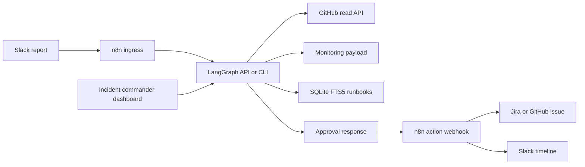
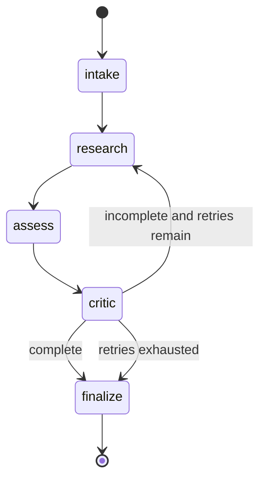

# IncidentOps architecture

## Boundary



Python reasons; n8n integrates. Python never stores Slack/Jira credentials and
never performs a write without approval.

## State and lifecycle

`IncidentState` is a JSON-serializable `TypedDict` containing:

- identity: `run_id`, Slack `channel_id` and `thread_ts`
- facts: summary, service, reporter, symptoms, owner
- evidence: monitoring events and GitHub context
- decision: severity, confidence, proposed actions, missing fields
- control: retries, approval, status, timeline, idempotency key

Lifecycle:

```text
running → awaiting_approval → succeeded
       ↘ needs_human
       ↘ failed
```

## Graph



| Node | Contract |
|---|---|
| `intake` | Normalize the Slack/n8n payload and identify missing required facts |
| `research` | Merge monitoring/GitHub evidence and retrieve cited runbook chunks |
| `assess` | Assign deterministic demo severity and propose reversible actions |
| `critic` | Cross-check facts/evidence; retry at most twice |
| `finalize` | Produce approval or escalation payload and persist checkpoint |

The implementation is deterministic for fixtures. A structured-output LLM can
later replace `assess` without changing state or routing.

## HTTP contract

Normalized request:

```json
{
  "run_id": "inc-123",
  "channel_id": "C123",
  "thread_ts": "1700000000.0001",
  "summary": "Checkout API returns 5xx",
  "service": "checkout",
  "reporter": "U123",
  "symptoms": ["error rate 12%"],
  "monitoring": {"error_rate": 0.12},
  "github": {"recent_deploy": "abc123"}
}
```

Response contains `run_id`, `idempotency_key`, `status`, `severity`,
`confidence`, `proposed_actions`, `timeline`, and `approval_required`.

## Approval and idempotency

n8n posts approve/reject buttons into the originating thread. The callback must
contain the same `run_id` and idempotency key. n8n stores processed keys before
creating a ticket; duplicate Slack delivery returns the existing result.

The FastAPI dashboard is a second view over the same checkpoint and decision
endpoints used by n8n. It has no separate state store, so Slack and browser
decisions cannot drift.

## Runbook retrieval

`workflow-run runbooks index` chunks Markdown by heading and builds a local
SQLite FTS5 index. Research searches with service, summary, and symptoms.
Results retain `path`, section title, excerpt, and rank; proposed actions cite
that source. SQLite is enough for the small runbook corpus and keeps retrieval
offline and reproducible. Add embeddings only if measured queries fail because
the incident and runbook use different vocabulary.

## Failure behavior

| Failure | Result |
|---|---|
| Missing service/summary | Retry research; then `needs_human` |
| Conflicting severity evidence | `needs_human` with conflict listed |
| Monitoring timeout | Continue with partial evidence; approval remains mandatory |
| Duplicate delivery | Same idempotency key; no duplicate action |
| n8n unavailable | Checkpoint remains resumable; no direct fallback write |

## Security

- Verify Slack signatures in n8n and keep credentials in n8n.
- Use read-only GitHub tokens for investigation.
- Treat Slack text and tool output as untrusted data, never instructions.
- Redact secrets before storing checkpoints.
- Require approval for every external write in the MVP.