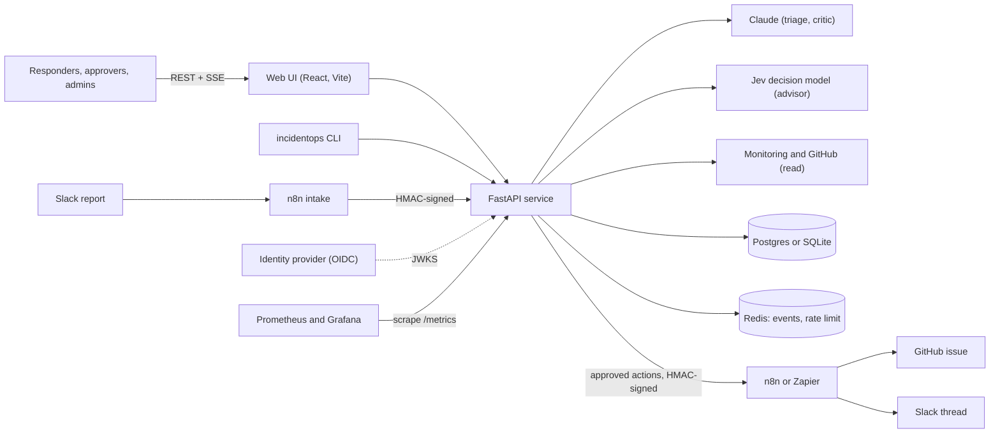
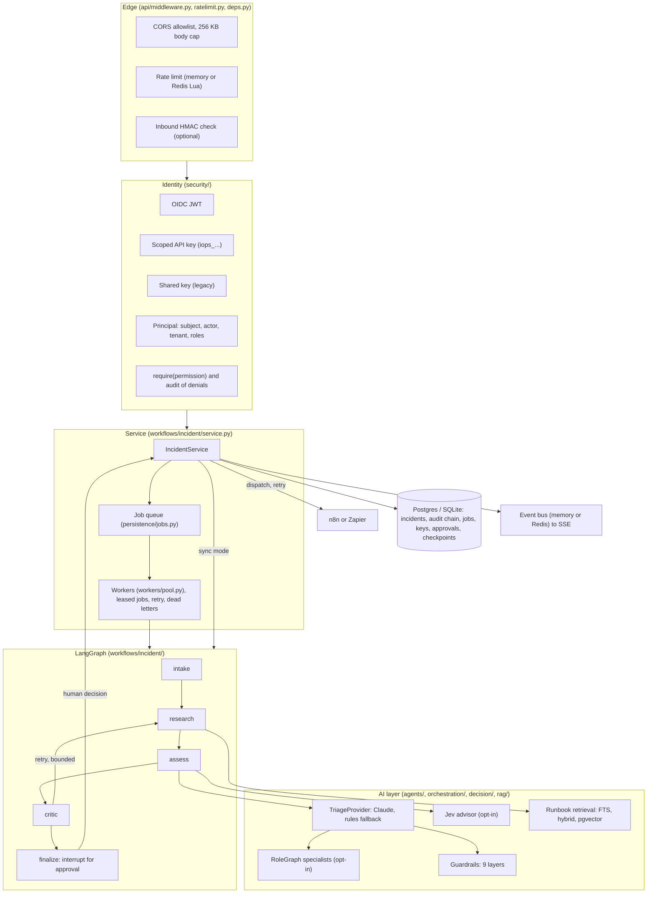
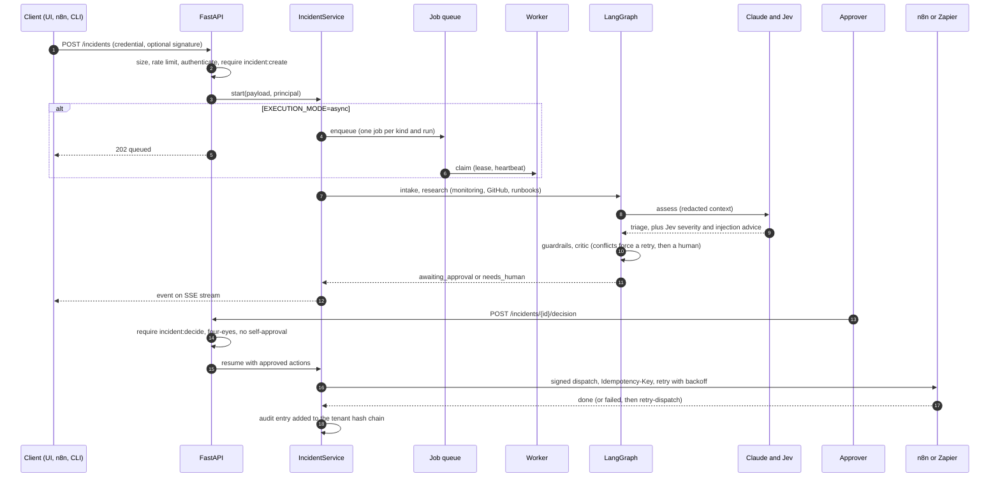
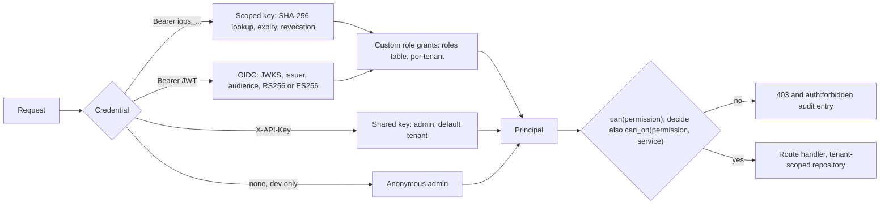
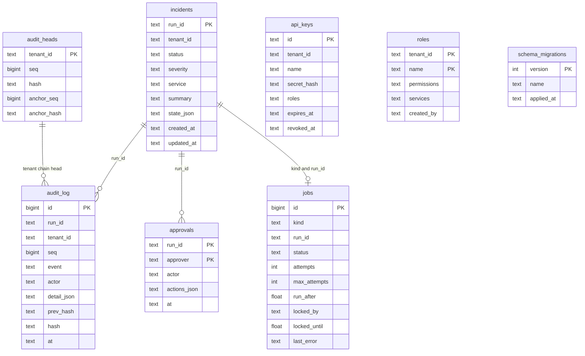
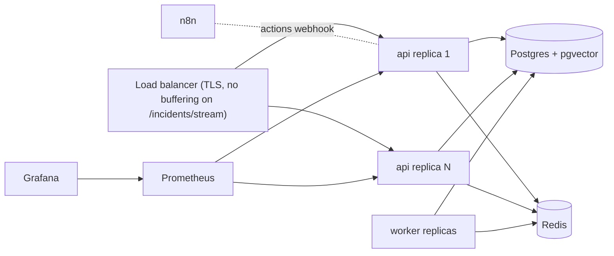
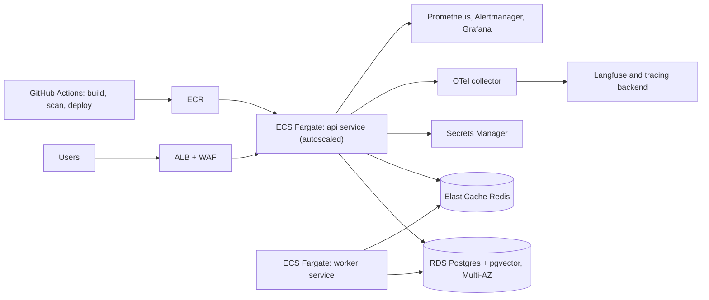

# End-to-end architecture

How an incident report becomes an approved, audited action, what the system is made of, and what
is worth adding next. Every statement about "today" traces to code in this repository; anything
marked **target** is a proposal, not built. For the details of one part, follow the links to
[ARCHITECTURE.md](ARCHITECTURE.md), [AI_SYSTEM_DESIGN.md](AI_SYSTEM_DESIGN.md),
[GUARDRAILS.md](GUARDRAILS.md), [DEPLOYMENT.md](DEPLOYMENT.md) and the [ADRs](adr/).

## 1. System context

The Python service holds no Slack or GitHub write credentials. Writes happen only in n8n or
Zapier, and only for actions a person approved.

## 2. Containers and components

The approval is a real LangGraph `interrupt()`. `POST /incidents/{id}/decision` resumes the same
thread. The AI and the people who report only **propose**; only `approver` and above can decide.

## 3. The request, step by step

Failures along the way:

- **Claude fails or breaks a guardrail:** the deterministic rules provider answers, and
  `fallback_reason` is recorded.
- **Jev fails:** no advice, a timeline note, and triage carries on.
- **A worker dies:** the lease expires, another worker claims the job and resumes from the
  checkpoint. With `CHECKPOINT_DURABILITY=exit` a run restarts from the beginning instead.
- **A job keeps failing:** after `JOB_MAX_ATTEMPTS` it is dead-lettered and the incident is
  `errored`; `retry-run` re-queues it.

## 4. Identity and RBAC

Roles are cumulative: `viewer` < `responder` < `approver` < `admin`. Permissions are in
`src/incidentops/security/principal.py`:

| Permission | Lowest role | What it allows |
|---|---|---|
| `incident:read` | viewer | list and open incidents, their trail, the live stream |
| `incident:create` | responder | open an incident |
| `incident:retry` | responder | retry a failed analysis or dispatch |
| `queue:read` | responder | queue counts and your dead jobs |
| `decision:invoke` | responder | ask the Jev decision model a question (`POST /decisions`) |
| `incident:decide` | approver | approve or reject proposed actions |
| `audit:search` | admin | search, export, verify the audit log |
| `incident:decide_high_risk` | approver | approve actions listed in `HIGH_RISK_ACTIONS` (rollback, scale ...) |
| `keys:manage` | admin | create, list, revoke scoped keys |
| `roles:manage` | admin | create, change, delete custom roles |
| `decision:admin` | admin | Jev configuration and usage (`GET /decisions/status`) |

Custom roles (ADR 013) add permissions per tenant, optionally limited to services matching globs; `incident:decide` is checked against the incident's service. Governance on top of roles: four-eyes approval for chosen severities (`FOUR_EYES_APPROVALS`,
`FOUR_EYES_SEVERITIES`), `FORBID_SELF_APPROVAL`, and `JEV_ALLOWED_TENANTS`. Tenancy is a
`tenant_id` filter inside the repository, so a route cannot forget it; another tenant's run is a
404. See [ADR 010](adr/010-identity-and-governance.md) and
[ADR 011](adr/011-jev-decision-advisor.md).

## 5. Data model

Not drawn: LangGraph checkpoint tables (`SqliteSaver` or `PostgresSaver`, keyed by
`thread_id = run_id`) and the runbook index (SQLite FTS5 file, or Postgres `tsvector` plus a
pgvector HNSW index when `RUNBOOK_STORE=postgres`). Relations are by convention, not foreign
keys. Migrations are a hand-written versioned list in `persistence/migrations.py`, applied under
a Postgres advisory lock.

## 6. Deployment

**Today** (`compose.yaml`, [DEPLOYMENT.md](DEPLOYMENT.md)): the API image, optional `worker`,
n8n, Postgres (pgvector) and Redis behind compose profiles, plus Prometheus and Grafana under
`observability`. Kubernetes manifests and Terraform do not exist.

**Target** (proposal): the same shape on managed services.

## 7. Observability

- **Metrics** (`core/metrics.py`, opt-in `/metrics`, token required outside dev): HTTP requests and
  latency, incidents, decisions, dispatches, rate-limited requests, build info. Four alerts in
  `monitoring/alerts.yml`; a 10-panel Grafana dashboard.
- **Tracing:** optional OpenTelemetry spans (run, each model call, n8n dispatch) when
  `OTEL_EXPORTER_OTLP_ENDPOINT` is set. No collector or backend is bundled.
- **Logs:** structlog JSON with `request_id` and `run_id`.
- **Health:** `/health` (liveness) and `/ready` (database, runbook index, action provider, Redis,
  dead jobs).
- **Dependencies:** `incidentops_circuit_state`, `_opened_total`, `_short_circuited_total` per
  dependency (model, Jev, dispatch) and `incidentops_jev_calls_total`, `_errors_total`,
  `_tokens_total` are read at scrape time.
- **Gaps:** token usage is counted but cost is not computed; no SLOs or burn-rate alerts; no
  Alertmanager.

## 8. Failure behaviour

| Failure | What happens today | Gap |
|---|---|---|
| Claude down, slow or off-policy | Rules provider answers; `fallback_reason` recorded; a circuit breaker stops calling the model after repeated provider errors | one LLM vendor only |
| Jev down or returns junk | No advice, a timeline note, triage continues; a circuit breaker stops the calls | no retry of a single call |
| Redis down | Events and rate limits fall back to per replica; `/ready` reports it | a client on another replica misses live events until its poll |
| Worker killed | Lease expires; another worker resumes from the checkpoint | with `CHECKPOINT_DURABILITY=exit` the run restarts |
| n8n or Zapier down | Dispatch retries with backoff, then the run is `failed`; a circuit breaker makes later dispatches fail at once; `retry-dispatch` resends | |
| API crashes between approval and dispatch | The approval records its intent first (outbox job); a worker, or the next start, sends it | a rare duplicate send is possible (n8n's Idempotency-Key absorbs it); without workers, recovery waits for the next start |
| Postgres down | `/ready` fails, requests error, workers retry | failover and restore are not rehearsed or documented |
| Audit-chain contention | Replicas serialise on one row lock per tenant | measured: about x1.2 from extra replicas; needs a design decision |

## 9. Security summary

| Threat | Control today | Residual risk |
|---|---|---|
| Stolen or forged credential | scoped keys stored as hash with expiry and revocation; OIDC with asymmetric algorithms and a mandatory audience | no refresh-token flow, MFA or per-user browser login; the shared key still works |
| Privilege misuse | RBAC on every route, denials audited, four-eyes, no self-approval | custom roles and per-service approval scope exist; no cache or revocation set, severity rules are only four-eyes |
| Cross-tenant access | tenant filter inside the repository; derived ids salted per tenant | no Postgres row-level security as a second layer |
| Prompt injection | 9 guardrail layers, closed action set, evidence grounding, Jev injection score, evals | scanner is heuristic and English-only |
| Data leaving the system | redaction before storage, prompts and Jev; owner and reporter never sent to Jev | pattern-based redaction misses free-text PII |
| Forged or replayed webhooks | HMAC-SHA256 over timestamp and body, 5-minute window | no nonce store, so replay inside the window is possible |
| SSRF through dispatch URLs | exact-hostname allowlist, no redirect following; link-local and unspecified addresses (cloud metadata) always refused after resolving the name; `OUTBOUND_BLOCK_PRIVATE` adds loopback and private ranges | an empty allowlist allows any host; a DNS answer that changes between check and connect is not caught |
| Audit tampering | per-tenant hash chain with verify and export | someone with full database control can rewrite log and head together |
| Secrets in config | `*_FILE` secrets, placeholder refusal outside dev | no secrets-manager integration |

## 10. What to add, in order

Priorities are by value to this system, not the order of any generic checklist.

**Tier 1: small and high value**

1. ~~`Idempotency-Key` on `POST /incidents`~~ **Done.** Built on the database rather than Redis: the run id is derived from the tenant and key, so it works across replicas with no extra store.
2. ~~Circuit breaker around Claude, Jev and n8n~~ **Done** (`core/resilience.py`). A retry for a single Jev call is not added.
3. ~~SSRF hardening~~ **Done** (`core/ssrf.py`): metadata and link-local always refused, private ranges opt-in.
4. ~~Role-aware UI~~ **Done**: approve and retry were already gated; the Report link, samples and page are now too, and the header shows role and tenant.
5. ~~Export Jev counters to Prometheus~~ **Done.** Token-to-cost is still open.
6. `/v1` route prefix for the public API: open. It changes every client (UI, n8n, CLI), so it needs a compatibility plan.

**Tier 2: moderate**

7. Redis Streams with `Last-Event-ID` replay for the live feed.
8. Cache-aside for key and role lookups, and a token-revocation set in Redis.
9. ~~Outbox for dispatch~~ **Done.** The intent is a job in the existing queue, armed before the run resumes and closed after the send; workers or the next start send what a crash left behind. It is not one database transaction with the approval (the checkpointer and read model are separate writes), so the intent is recorded first, which makes the failure mode a duplicate rather than a loss.
10. ~~Custom roles per tenant and ABAC rules~~ **Done** ([ADR 013](adr/013-custom-roles-and-abac.md)): roles in the database, resolved on every request; approval limited to a role's services; `HIGH_RISK_ACTIONS` need `incident:decide_high_risk`. Not done: scoping reads by service, severity rules beyond four-eyes.
11. Postgres row-level security for tenancy.
12. Langfuse or an OTel collector; SLOs with burn-rate alerts and Alertmanager.
13. Playwright end-to-end tests and schemathesis against the OpenAPI schema.

**Tier 3: larger**

14. Per-user login: OIDC authorization code with PKCE and refresh rotation (MFA via the IdP).
15. A second LLM provider in the fallback chain, and LLM-driven tool calling plus a real MCP client (today `tools/mcp/bridge.py` is a stub).
16. Retrieval: reciprocal-rank fusion and a cross-encoder reranker; LLM-as-judge and trajectory evals, including a harness that scores Jev against the incident dataset.
17. Notifications beyond n8n Slack, per-tenant usage metering and limits, incident export, retention and delete.
18. Terraform and ECS Fargate (or Helm if Kubernetes is justified), a CD pipeline, image scanning and an SBOM.

**Needs a decision:** how to scale the audit chain (per-tenant sharding or async sealing). Either
changes audit semantics, so it is not on the list until it is chosen.

**Deliberately not added:** Celery, RabbitMQ and Kafka (the job queue is durable and the load
test points at the audit-chain lock, not the queue), Next.js ([ADR 005](adr/005-react-frontend.md)),
SQLAlchemy and Alembic (raw SQL with versioned migrations is intentional), WebSockets
([ADR 004](adr/004-sse-over-websocket.md)), GraphQL, gRPC, microservices. See
[ADR 012](adr/012-target-architecture-roadmap.md).

### Coverage against the engineering checklist

| Domain | Done | Partial | Missing |
|---|---|---|---|
| API | FastAPI, Pydantic, OpenAPI, validation, middleware, rate limiting, webhooks and signing, `Idempotency-Key` | pagination (no sort, no cursors) | versioning |
| Auth and RBAC | OIDC, JWT validation, API keys, RBAC, resource-level tenant checks, four-eyes | custom roles, per-service approval scope, high-risk action rule, four-eyes | refresh tokens, MFA, sessions, permission cache |
| Data | Postgres, pgvector, hybrid search, migrations, transactions, pooling | multi-tenancy (app level only) | RLS, soft deletes, partitioning, replicas |
| Redis | events, rate limiting | n8n idempotency (separate Redis) | locks, caches, streams, nonce store |
| Queues | durable queue, leases, retries, backoff, dead letters, dispatch outbox | idempotent consumers | event replay, Celery (skipped) |
| Reliability | timeouts, fallback, circuit breakers, health checks, graceful shutdown, idempotent create | | bulkheads, failover docs |
| AI | structured output, fallback, RAG, hybrid retrieval, LangGraph checkpoints and interrupts, multi-agent, guardrails, evals | tracing, token tracking | tool calling, real MCP, reranker, Langfuse, cost tracking |
| Frontend | React, TypeScript, Tailwind, TanStack Query, SSE, role-aware UI | tests (unit only) | Zod, Playwright |
| Security | redaction, audit chain, secrets files, CORS, body caps, SSRF guard | replay protection | secrets manager, image scanning, CSRF (not needed without cookies) |
| Observability | Prometheus, Grafana, structured logs, OTel spans, alerts | metrics coverage | Loki, Sentry, SLOs, Alertmanager |
| DevOps | Docker, compose, GitHub Actions CI, release to GHCR | | CD, Terraform, Kubernetes, AWS |
| Product | incidents, approval, audit, keys | notifications, export, retention | users, invitations, billing, metering |
