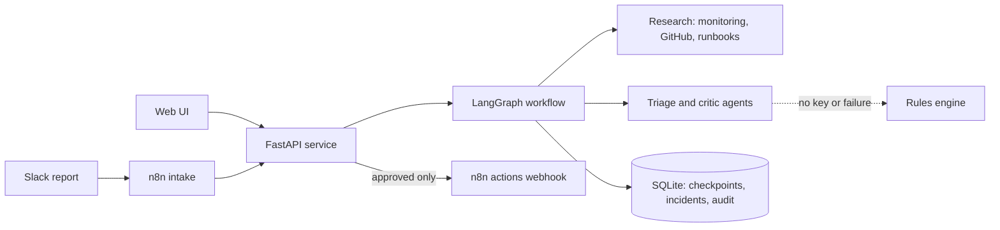

# Portfolio guide

A short path for reviewers, interviewers, and hiring managers. The hands-on
README is the operator manual; this page is the **why** and **proof**.

## Problem and constraint

Incident triage starts as a noisy Slack message. An AI helper is useful only if
people can trust it during an outage. This project therefore **never** lets the
model write to Slack, GitHub, or ticketing systems on its own.

**Design rule:** the model proposes, a person approves, n8n executes.

## Architecture (30 seconds)



Multi-agent here means **roles with boundaries**, not a large swarm:

| Role | Responsibility |
|---|---|
| Researcher | Tools only: monitoring, GitHub, runbook RAG |
| Triage | Structured proposal (severity, actions, evidence) |
| Critic | Bounded review loop back into research |
| Human | LangGraph `interrupt()` before any dispatch |

A five-agent specialist graph was benchmarked and **rejected** (no quality gain,
higher latency). See [ADR 006](adr/006-reject-specialist-swarm-for-current-scope.md)
and [evals/architecture_report.md](../evals/architecture_report.md).

## RAG

Runbooks are chunked by Markdown heading and indexed with **SQLite FTS5** (BM25).
Actions must cite `runbook:<path>` that exists in the retrieved hits. Optional
**hybrid** retrieval (FTS candidates + local embeddings) sits behind
`RUNBOOK_RETRIEVAL=hybrid` and is measured with `make eval-retrieval`. Default
remains FTS until the labeled retrieval suite justifies a switch
([ADR 007](adr/007-hybrid-runbook-retrieval.md)).

## Evidence (reproduce locally)

```bash
make setup && make web-build
make check          # lint, types, coverage, incident + guardrail evals, UI tests
make eval-retrieval # recall@k / MRR on labeled runbook queries (FTS + hybrid report)
make demo           # one incident end-to-end in the terminal
make dev            # API on :8000 — load a sample incident in the UI
```

**Labeled quality**

| Suite | What it measures | Report |
|---|---|---|
| Core + guardrails (37 cases) | Severity, grounding, safety, prompt injection | [evals/report.md](../evals/report.md) |
| Core only (10 cases) | Original smoke set | same report, filter by case name |
| Rules vs Claude | Same cases, two providers | [evals/report-claude.md](../evals/report-claude.md) (`make eval-claude`, needs API key) |
| Retrieval | recall@k, MRR, top-1 path | [evals/retrieval_report.md](../evals/retrieval_report.md) |
| Architecture | 2-role vs 5-role graph | [evals/architecture_report.md](../evals/architecture_report.md) |

**Tests:** 110+ Python tests with coverage gate, 48 UI tests, mypy strict on
`src/incidentops`.

## Live demo script (≈3 minutes)

1. `make dev`, open <http://localhost:8000>, click **Load a sample incident**.
2. Walk the pipeline stepper and evidence panel; note runbook citations.
3. Open a second tab on the same incident; approve partial actions — first tab
   updates over SSE.
4. Optional failure drill: reject a run or retry dispatch ([WALKTHROUGH.md](WALKTHROUGH.md)).

Docker: `docker compose up --build` for API + n8n (pilot behind your VPN).

## Interview talking points

1. **Human-in-the-loop by construction** — approval is a real graph interrupt,
   not a UI checkbox that skips the workflow.
2. **Grounding in code** — closed action enum; evidence refs validated after the
   model; rules fallback on any provider failure.
3. **Eval-driven complexity** — specialist swarm rejected with data; hybrid RAG
   gated by retrieval metrics.
4. **Operational split** — Python reasons; n8n holds Slack/GitHub credentials.
5. **Honest limits** — SQLite single instance, shared API key, Slack signature
   verification left to deployers ([PROJECT_BRIEF.md](PROJECT_BRIEF.md)).

## Resume bullets (accurate phrasing)

- Built a human-in-the-loop incident copilot: LangGraph workflow with SQLite
  checkpointing and approval interrupts.
- Multi-agent triage + critic with bounded research loop; architecture benchmark
  rejected a 5-agent specialist topology.
- RAG over runbooks (FTS5 + optional hybrid rerank); retrieval evals for
  recall@k and MRR.
- Deterministic rules fallback, guardrail eval suite, idempotent action dispatch
  via n8n.

## Further reading

- [AI design](AI_DESIGN.md) · [Architecture](ARCHITECTURE.md) · [Security](../SECURITY.md)
- [Decision records](adr/) · [Demo script](DEMO_SCRIPT.md)