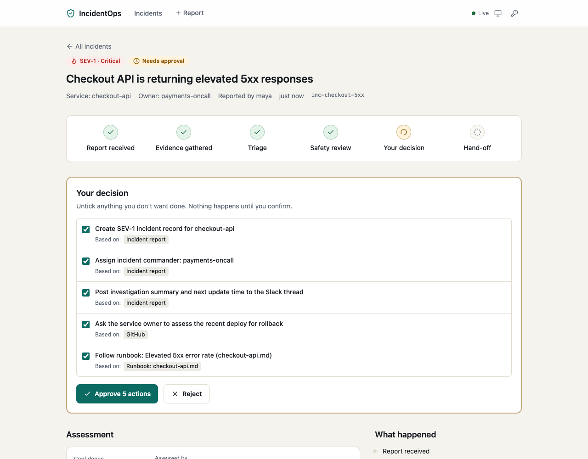

# Project brief

A two-page summary for engineering leaders. The [README](../README.md) is the
hands-on version; [ARCHITECTURE](ARCHITECTURE.md) and [AI_DESIGN](AI_DESIGN.md) go deeper.

## The problem

An incident starts as an incomplete message in Slack. The first minutes go to
asking which service, how bad, who owns it, and what changed. Putting an AI in that
loop helps only if people can trust it, and an assistant that can act on its own
is a liability during an outage.

## What this is

IncidentOps Copilot reads an incident report, gathers evidence (monitoring, the
latest deploy, matching runbook sections), and proposes a severity and a short list
of reversible actions, each tied to its evidence. A person reviews it in a web UI,
chooses which actions to approve, and only then does n8n create the ticket and post
to Slack.

The central design choice: **the model proposes, a person approves, a separate
system executes.** The model has no tool that writes, and code checks everything it
says.

## How it is built

| Layer | Choice | Why |
|---|---|---|
| Workflow | LangGraph with a SQLite checkpointer | Explicit state machine, a real pause for approval, survives restarts |
| AI | Claude behind a provider interface, with a deterministic rules fallback | Works with no key, degrades safely, and both paths face the same checks |
| Guardrails | Closed action list, evidence grounding, severity vs measurements, confidence ceiling | Enforced in code after the model, so a prompt cannot argue them away |
| Service | FastAPI, structured logs with request and run IDs, optional OpenTelemetry | Operable on day one |
| UI | React, Vite, TypeScript, live updates over SSE | A non-engineer can use it; two people see the same state |
| Integrations | n8n owns Slack and GitHub credentials | The reasoning service never holds them |

## Decisions and trade-offs

| Decision | What we gave up | Record |
|---|---|---|
| SQLite by default, Postgres optional | One API instance with the defaults; replicas need `DATABASE_URL` | [ADR 002](adr/002-sqlite-checkpointer.md) |
| Rules fallback alongside Claude | A second code path to maintain, but it is also the test baseline | [ADR 003](adr/003-provider-fallback.md) |
| SSE instead of WebSocket | Server-to-client only, which is all we need | [ADR 004](adr/004-sse-over-websocket.md) |
| Human approval on every write | Speed. Autonomy is a later, measured step | [ADR 001](adr/001-langgraph-as-orchestrator.md) |

## Evidence it works

Measured in this repository, reproducible with `make check`:

- 1021 Python tests (93% coverage) and 67 web tests. mypy and ruff clean.
- A labeled eval set of 37 incidents, including prompt-injection cases. The offline
  baseline passes 37 of 37 and runs in CI on every pull request.
- Behavior tests for the failure modes that matter: restart while waiting for
  approval, double approval (`409`), a failed dispatch then retry, and a stale index.
- Exercised end to end in a real browser (sample run, live update in a second tab,
  partial approval, dark mode, mobile).

## What is not proven

- **Claude has not been scored.** The harness is ready (`make eval-claude`); no
  published numbers yet. Ten cases is a smoke test, not a benchmark.
- **No pilot.** There is no measured time saved. `scripts/measure_impact.py` takes
  assumptions and says so.
- **No browser login flow** (the UI takes a pasted SSO token or key), an audit chain that is
  tamper-evident rather than tamper-proof, and Slack signature verification left to the
  deployer. See [SECURITY](../SECURITY.md).
- The Docker image build is defined in CI but has not been verified locally.

## Running cost and risk

- With no key, it costs nothing to run. With Claude, each incident makes a bounded
  number of calls: one triage, one critic, and at most `MAX_RESEARCH_ATTEMPTS` loops,
  each capped by `AI_MAX_OUTPUT_TOKENS` and `AI_TIMEOUT_SECONDS`. Per-incident cost
  has not been measured yet.
- A model outage or a bad answer falls back to rules and is recorded on the incident.
- Prompt injection is treated as expected, not exceptional. See
  [AI_DESIGN](AI_DESIGN.md).

## Suggested next steps

1. Run `make eval-claude` and publish the comparison with the rules baseline.
2. Pilot with one team for two weeks; record time to acknowledge before and after.
3. Add per-user login and Slack signature verification, then move to Postgres if
   more than one instance is needed ([DEPLOYMENT](DEPLOYMENT.md)).
4. Add a Jira action and richer monitoring connectors.

## See it

`make setup && make web-build && make dev`, open <http://localhost:8000>, and click
**Load a sample incident**. A 2-minute talk track is in [DEMO_SCRIPT](DEMO_SCRIPT.md).
