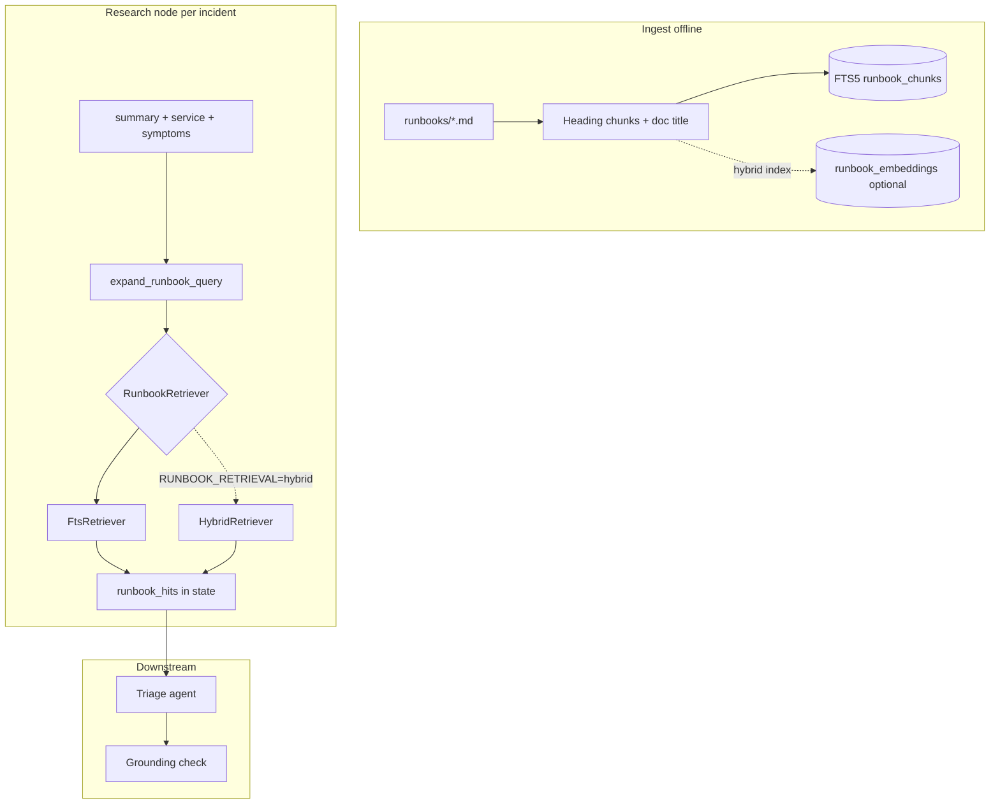

# RAG system design

How runbook retrieval is built, measured, and wired into a **grounded** multi-agent
workflow. Use this page in interviews when they ask “walk me through your RAG.”

## Problem

Incident triage needs **citable** runbook sections, not a chatty summary. The model
may only propose `follow_runbook` when `runbook:<path>` appears in retrieved hits
([`agents/guardrails.py`](../src/incidentops/agents/guardrails.py)). Retrieval quality
is therefore a **safety** property, not a nice-to-have.

## Design goals

| Goal | How we meet it |
|---|---|
| Offline / reproducible | SQLite FTS5; no hosted vector DB required |
| Grounded actions | Same hit shape flows to UI and guardrails |
| Measurable | Labeled retrieval suite + CI (`make eval-retrieval`) |
| Complexity only when earned | Hybrid embeddings optional; ADR gates the default |
| No LLM in the retrieval path (default) | Rule-based query rewrite, not “ask GPT to search” |

## End-to-end flow

**CLI:** `incidentops runbooks index` rebuilds the index (`make index`).

**Config:** `RUNBOOK_RETRIEVAL=fts|hybrid` (`.env.example`).

## Code layout (`src/incidentops/rag/`)

| Module | Responsibility |
|---|---|
| [`fts.py`](../src/incidentops/rag/fts.py) | Chunk MD by `##` headings; index `doc` (H1 + filename) for service match; BM25 + `prefer` boost |
| [`rewrite.py`](../src/incidentops/rag/rewrite.py) | Service aliases + symptom phrase → expanded BM25 query (deterministic) |
| [`hybrid.py`](../src/incidentops/rag/hybrid.py) | `fastembed` vectors in SQLite; FTS top-20 → cosine rerank + service boost |
| [`retriever.py`](../src/incidentops/rag/retriever.py) | `RunbookRetriever` protocol; `build_runbook_retriever(settings)` |

Integrations (GitHub, monitoring) stay in `tools/`; **knowledge retrieval is its own package**.

Legacy imports via `incidentops.tools.runbooks` still work (thin shims).

## Chunking strategy

1. Split on `#` / `##` / `###` headings (max 4000 chars per section).
2. Index `doc` = first H1 + file stem so “checkout-api” matches the runbook even when
   symptoms use different words ([`fts._doc_title`](../src/incidentops/rag/fts.py)).
3. Weights: `bm25(runbook_chunks, 1.0, 2.0, 2.0, 1.0)` — title and `doc` rank above body.

## Query rewrite (why not embed everything by default)

Symptom reports use colloquial language (“users cannot complete purchases”). FTS
needs overlapping tokens. Rewrite adds **service aliases** and **symptom→domain**
terms without an LLM call—cheap, testable, no new failure mode.

Production research always runs **rewrite then FTS** ([`nodes.make_research`](../src/incidentops/workflows/incident/nodes.py)).

## Hybrid mode (optional)

When `RUNBOOK_RETRIEVAL=hybrid` and `pip install '.[rag]'`:

1. Index builds FTS + `runbook_embeddings` (BGE-small-en, normalized float32 blobs).
2. Search: FTS candidates → fused score `0.55·dense + 0.35·fts_rank + 0.10·prefer`.
3. If FTS returns nothing, fall back to full-corpus dense search (fine for small N).

**Default stays FTS + rewrite** because labeled evals hit **100% recall@k** without
vectors. Hybrid is there to show you know the pattern and to scale up later.
See [ADR 007](adr/007-hybrid-runbook-retrieval.md).

## Evaluation (proof, not vibes)

| Artifact | Command |
|---|---|
| [evals/retrieval_report.md](../evals/retrieval_report.md) | `make eval-retrieval` |
| Cases | [evals/dataset/retrieval/](../evals/dataset/retrieval/) |
| Metrics | recall@k, MRR, top-1 path ([`retrieval_scorers.py`](../evals/retrieval_scorers.py)) |

**Latest snapshot (regenerate before interviews):**

| Mode | Mean recall@k | Notes |
|---|---:|---|
| Raw FTS | ~82% (11 cases) | Vocabulary mismatch on semantic symptom phrasing |
| FTS + rewrite | 100% | **Shipping default** |
| Hybrid + rewrite | 100% | Optional; proves dense path |

CI runs `fts` + `rewrite` on every PR (no `fastembed` required).

## Interview sound bites

1. **“RAG is constrained by grounding.”** Bad retrieval ⇒ model cannot cite ⇒
   `follow_runbook` is blocked in code.
2. **“We benchmarked before adding agents and vectors.”** Specialist swarm rejected
   ([ADR 006](adr/006-reject-specialist-swarm-for-current-scope.md)); hybrid gated
   ([ADR 007](adr/007-hybrid-runbook-retrieval.md)).
3. **“Default stack is boring on purpose.”** FTS + rules rewrite = offline, fast,
   CI-friendly; embeddings are an upgrade path, not a dependency.
4. **“Same interface, bigger store later.”** `RunbookRetriever` can back onto
   Pgvector/Qdrant without changing the graph ([DEPLOYMENT.md](DEPLOYMENT.md)).

## Related

- [AI design](AI_DESIGN.md) · [Architecture](ARCHITECTURE.md) · [Portfolio](PORTFOLIO.md)
- [Repository map](REPOSITORY_MAP.md) · [Eval suites](../evals/README.md)