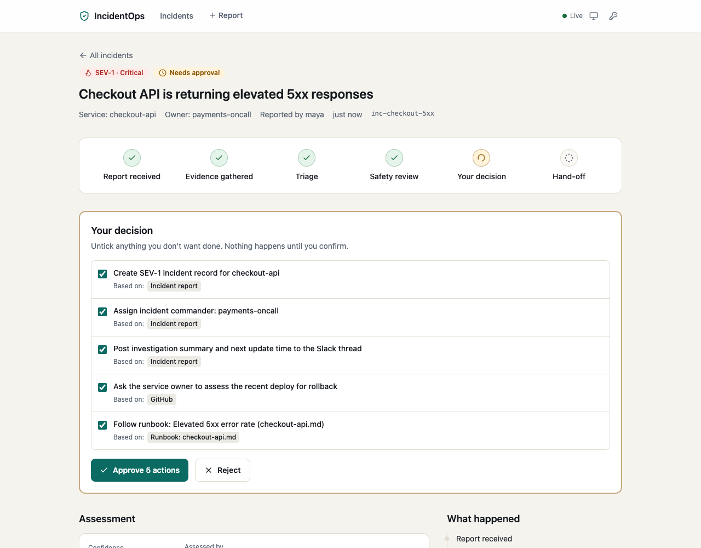

<div align="center">

<p align="center"></p>
<h1 align="center">IncidentOps Copilot: triaje de incidentes con IA aprobado por una persona</h1>

<p align="center"><b>La IA propone. Una persona aprueba. Solo entonces sale algo al exterior.</b></p>

<p align="center">
  <a href="../../README.md"></a>&nbsp;
  <a href="README.zh-CN.md"></a>&nbsp;
  <a href="README.hi.md"></a>&nbsp;
  <a href="README.es.md"></a>
</p>

<p align="center">
  
  
  
</p>

</div>

> Esta es una traducción resumida. **El [README en inglés](../../README.md) es la versión de referencia**: allí están todas las cifras y los detalles de configuración, y se mantiene al día con el código.

<div align="center">

</div>

## Qué hace

Un compañero escribe en Slack: «checkout devuelve errores 5xx». Copilot:

1. **Reúne evidencia**: revisa los cambios recientes en GitHub y los datos de monitorización.
2. **Encuentra tu runbook**: busca los pasos aplicables en tus propios runbooks en Markdown ([runbooks/](../../runbooks)).
3. **Propone un plan**: una severidad, una lista corta de acciones seguras y reversibles, y la evidencia detrás de cada una.
4. **Espera**: quien dirige el incidente revisa la evidencia en la web, desmarca lo que no quiere y aprueba.
5. **Actúa**: solo las acciones aprobadas crean el issue de GitHub, responden en el hilo de Slack y envían el correo de estado, a través de n8n (o Zapier).

Ahorra el tiempo del «¿por dónde empiezo?». **No sustituye** a la persona responsable.

## Características principales

- 🤝 **Humano en el circuito, de verdad**: la aprobación es un `interrupt()` real de LangGraph, no una reejecución.
- 🧾 **Cada acción cita su evidencia**: se comprueba en código, no pidiéndoselo al modelo.
- 🔌 **Funciona sin clave de API**: un motor de reglas determinista ejecuta todo sin conexión; Claude es una mejora opcional.
- 🛡️ **Entradas y salidas hostiles controladas**: el texto del incidente se aísla y se redacta, y el modelo no puede añadir acciones fuera de una lista cerrada.
- 🔁 **Fiable**: las ejecuciones sobreviven a reinicios, aprobar y crear son idempotentes, los envíos fallidos se pueden reintentar y el registro de auditoría solo añade.
- 📏 **Medido**: cuatro suites de evaluación se ejecutan en cada pull request.
- 📈 **Observable**: `/metrics` de Prometheus opcional y un perfil de Docker Compose con un panel de Grafana.
- 🗄️ **Escalable**: Postgres y Redis opcionales para que varias réplicas de la API compartan estado.

## Empieza en 60 segundos

Sin claves de API, sin Slack, sin n8n.

```bash
git clone https://github.com/ft-kumarsatyam/incidentops-copilot.git
cd incidentops-copilot
make setup && make web-build && make dev
```

Abre <http://localhost:8000> y pulsa **Load a sample incident**. Aprueba desde otra pestaña y la primera se actualizará en vivo.

Con Docker: `docker compose up --build`. Para monitorización: `docker compose --profile observability up --build` (Grafana en <http://localhost:3000>).

## Evaluación

| Suite | Comando |
|---|---|
| Triaje de incidentes | `make eval` |
| Guardarraíles (tasa de bloqueo y falsos positivos) | `make eval-guardrails` |
| Recuperación de runbooks | `make eval-retrieval` |
| Comparación de arquitecturas | `make eval-architecture` |

Las cifras actuales están en las insignias de arriba y en la [sección Evaluation del README en inglés](../../README.md#-evaluation).

## Documentación

- [Arquitectura](../ARCHITECTURE.md) · [Diseño del sistema de IA](../AI_SYSTEM_DESIGN.md) · [Guardarraíles](../GUARDRAILS.md)
- [Despliegue](../DEPLOYMENT.md) · [Integraciones](../INTEGRATIONS.md) · [Seguridad](../../SECURITY.md)
- [Cómo contribuir](../../CONTRIBUTING.md)

Licencia: MIT.
