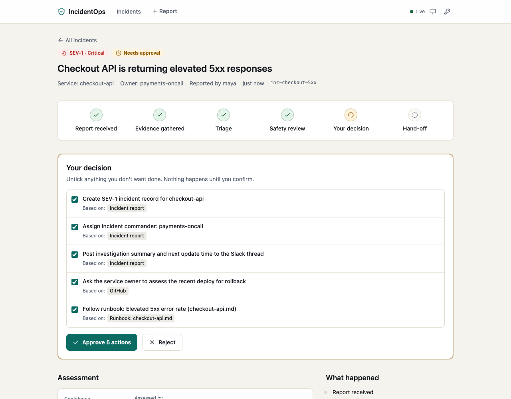

<div align="center">

<p align="center"></p>
<h1 align="center">IncidentOps Copilot: इंसान की मंज़ूरी वाला AI इंसिडेंट ट्राइएज</h1>

<p align="center"><b>AI सुझाव देता है। इंसान मंज़ूरी देता है। उसके बाद ही कुछ बाहर जाता है।</b></p>

<p align="center">
  <a href="../../README.md"></a>&nbsp;
  <a href="README.zh-CN.md"></a>&nbsp;
  <a href="README.hi.md"></a>&nbsp;
  <a href="README.es.md"></a>
</p>

<p align="center">
  
  
  
</p>

</div>

> यह संक्षिप्त अनुवाद है। **अंग्रेज़ी [README](../../README.md) ही मूल है**: सारे आँकड़े और कॉन्फ़िगरेशन का पूरा ब्योरा वहीं है और कोड के साथ अपडेट होता है।

<div align="center">

</div>

## यह क्या करता है

कोई साथी Slack में लिखता है: "checkout में 5xx errors आ रहे हैं।" Copilot:

1. **सबूत जुटाता है**: GitHub के हाल के बदलाव और मॉनिटरिंग डेटा देखता है।
2. **सही runbook ढूँढता है**: आपके अपने Markdown runbooks ([runbooks/](../../runbooks)) में मिलते-जुलते कदम खोजता है।
3. **योजना सुझाता है**: एक severity, सुरक्षित और पलटे जा सकने वाले कदमों की छोटी सूची, और हर कदम के पीछे का सबूत।
4. **आपका इंतज़ार करता है**: इंसिडेंट कमांडर वेब पेज पर सबूत पढ़ता है, जो कदम नहीं चाहिए उन्हें हटाता है, और मंज़ूरी देता है।
5. **अमल करता है**: केवल मंज़ूर किए गए कदम n8n (या Zapier) के ज़रिए GitHub issue बनाते हैं, Slack थ्रेड में जवाब देते हैं और स्टेटस ईमेल भेजते हैं।

यह "शुरू कहाँ से करें?" वाला समय बचाता है। यह ज़िम्मेदार व्यक्ति की जगह **नहीं** लेता।

## मुख्य विशेषताएँ

- 🤝 **इंसान ज़रूरी है**: मंज़ूरी असली LangGraph `interrupt()` है, दोबारा चलाना नहीं।
- 🧾 **हर कदम सबूत का हवाला देता है**: यह जाँच कोड में होती है, prompt पर भरोसा करके नहीं।
- 🔌 **बिना API key के भी चलता है**: बिल्ट-इन rules engine पूरा फ़्लो offline चलाता है। Claude वैकल्पिक अपग्रेड है।
- 🛡️ **ख़तरनाक इनपुट/आउटपुट से बचाव**: इंसिडेंट टेक्स्ट अलग रखा और साफ़ किया जाता है; मॉडल तय सूची के बाहर के कदम नहीं सुझा सकता।
- 🔁 **भरोसेमंद**: रन रीस्टार्ट के बाद भी बचे रहते हैं, मंज़ूरी और शुरुआत idempotent हैं, फ़ेल हुए dispatch दोबारा चलाए जा सकते हैं, audit log केवल बढ़ता है।
- 📏 **नापा हुआ**: चार eval suites हर pull request पर चलते हैं।
- 📈 **निगरानी योग्य**: वैकल्पिक Prometheus `/metrics` और Grafana dashboard वाला Docker Compose profile।
- 🗄️ **स्केल-आउट**: वैकल्पिक Postgres और Redis से कई API replicas एक ही state साझा करते हैं।

## 60 सेकंड में शुरू करें

API key, Slack या n8n की ज़रूरत नहीं।

```bash
git clone https://github.com/ft-kumarsatyam/incidentops-copilot.git
cd incidentops-copilot
make setup && make web-build && make dev
```

<http://localhost:8000> खोलें और **Load a sample incident** दबाएँ। दूसरे टैब में मंज़ूरी दें; पहला टैब लाइव अपडेट होगा।

Docker से: `docker compose up --build`। मॉनिटरिंग के लिए: `docker compose --profile observability up --build` (Grafana: <http://localhost:3000>)।

## मूल्यांकन (Evaluation)

| Suite | कमांड |
|---|---|
| इंसिडेंट ट्राइएज | `make eval` |
| Guardrails (हमलों को रोकने की दर और झूठे अलर्ट) | `make eval-guardrails` |
| Runbook retrieval | `make eval-retrieval` |
| आर्किटेक्चर तुलना | `make eval-architecture` |

ताज़ा आँकड़े ऊपर के बैज और [अंग्रेज़ी README के Evaluation सेक्शन](../../README.md#-evaluation) में हैं।

## दस्तावेज़

- [Architecture](../ARCHITECTURE.md) · [AI system design](../AI_SYSTEM_DESIGN.md) · [Guardrails](../GUARDRAILS.md)
- [Deployment](../DEPLOYMENT.md) · [Integrations](../INTEGRATIONS.md) · [Security](../../SECURITY.md)
- [Contributing](../../CONTRIBUTING.md)

लाइसेंस: MIT।
