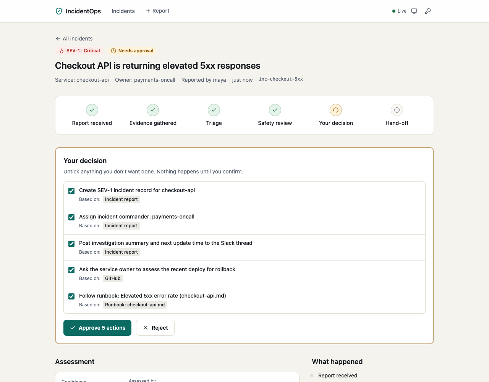

<div align="center">

<p align="center"></p>
<h1 align="center">IncidentOps Copilot：由人审批的 AI 故障分诊助手</h1>

<p align="center"><b>AI 只负责提出方案，由人来批准，批准之后才会有任何动作发出。</b></p>

<p align="center">
  <a href="../../README.md"></a>&nbsp;
  <a href="README.zh-CN.md"></a>&nbsp;
  <a href="README.hi.md"></a>&nbsp;
  <a href="README.es.md"></a>
</p>

<p align="center">
  
  
  
</p>

</div>

> 这是精简版译文。**以[英文 README](../../README.md)为准**，所有数字与配置细节都在那里，并随代码更新。

<div align="center">

</div>

## 它做什么

同事在 Slack 里说"结账接口大量返回 5xx"。Copilot 会：

1. **收集证据**：查看 GitHub 上的近期变更和监控数据。
2. **匹配运行手册**：在你自己写的 Markdown 运行手册（[runbooks/](../../runbooks)）中检索对应步骤。
3. **给出方案**：严重级别、一组可回滚的安全动作，以及每个动作所依据的证据。
4. **等待审批**：值班负责人在网页上查看证据，取消不同意的动作，然后批准。
5. **执行**：只有被批准的动作才会通过 n8n（或 Zapier）创建 GitHub issue、回复 Slack 线程、发送状态邮件。

它节省的是"从哪里开始"的时间，**不会取代负责人**。

## 主要特点

- 🤝 **强制有人参与**：审批是真正的 LangGraph `interrupt()`，不是重新运行。
- 🧾 **每个动作都要引用证据**：由代码检查，而不是靠提示词。
- 🔌 **没有 API 密钥也能运行**：内置规则引擎可离线跑完整流程，Claude 是可选升级；模型出错时自动回退到规则引擎。
- 🛡️ **防御恶意输入输出**：事件文本被隔离和脱敏，模型不能提出封闭清单之外的动作。
- 🔁 **可靠**：运行可在重启后恢复，审批和创建都是幂等的，失败的分发可以重试，审计日志只追加。
- 📏 **可度量**：四套评测在每个 PR 上运行；多智能体方案必须胜过单智能体基线才会被采用。
- 📈 **可观测**：可选的 Prometheus `/metrics`，以及自带 Grafana 仪表盘的 Docker Compose 配置。
- 🗄️ **可横向扩展**：可选 Postgres 与 Redis，让多个 API 副本共享状态。

## 60 秒上手

不需要 API 密钥、Slack 或 n8n。

```bash
git clone https://github.com/ft-kumarsatyam/incidentops-copilot.git
cd incidentops-copilot
make setup && make web-build && make dev
```

打开 <http://localhost:8000>，点击 **Load a sample incident**。再开一个标签页进行审批，第一个标签页会实时更新。

使用 Docker：`docker compose up --build`。想看监控：`docker compose --profile observability up --build`（Grafana 在 <http://localhost:3000>）。

## 评测

| 评测 | 命令 |
|---|---|
| 事件分诊 | `make eval` |
| 护栏（恶意输出拦截率与误报率） | `make eval-guardrails` |
| 运行手册检索 | `make eval-retrieval` |
| 架构对比（单智能体 vs 并行专家） | `make eval-architecture` |

最新数值见顶部徽章与[英文 README 的评测一节](../../README.md#-evaluation)。

## 文档

- [系统架构](../ARCHITECTURE.md) · [AI 系统设计](../AI_SYSTEM_DESIGN.md) · [护栏](../GUARDRAILS.md)
- [部署指南](../DEPLOYMENT.md) · [集成](../INTEGRATIONS.md) · [安全](../../SECURITY.md)
- [贡献指南](../../CONTRIBUTING.md)

许可证：MIT。
