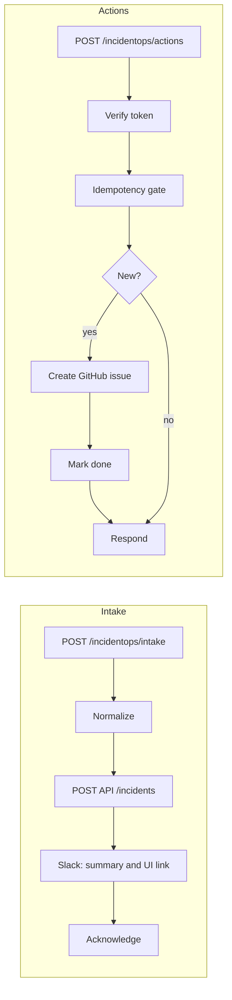

# n8n workflow

n8n owns the Slack and GitHub credentials and performs every write. The Python
service only ever sends it an approved request.

Import `incident-ops.json` through **Workflows → Import from file**, then
activate it.

## Environment values

| Variable | Purpose |
|---|---|
| `INCIDENTOPS_URL` | Base URL of the API as n8n reaches it (`http://api:8000` in Compose) |
| `INCIDENTOPS_API_KEY` | Sent to the API as `X-API-Key` |
| `INCIDENTOPS_PUBLIC_URL` | Where people open the UI; used for the link in Slack |
| `N8N_ACTION_TOKEN` | Shared secret. Must equal the API's `N8N_ACTION_TOKEN` |
| `SLACK_BOT_TOKEN` | Bot allowed to post in the incident channel |
| `GITHUB_TOKEN` | Issue-write token scoped to one repository |
| `GITHUB_REPO` | `owner/repository` |
| `NOTIFY_EMAIL_TO` | Optional status email after approval (SMTP must be configured in n8n) |
| `NOTIFY_FROM_EMAIL` | From address for status email |

n8n 2.x blocks `$env` inside nodes by default. Compose sets
`N8N_BLOCK_ENV_ACCESS_IN_NODE=false` because this workflow reads its settings
that way. If you run n8n yourself, set it too.

Set the API's `N8N_ACTION_WEBHOOK_URL` to
`<n8n base>/webhook/incidentops/actions`.

## Flows

**Intake.** Slack events hit `incidentops/intake`. The workflow normalizes the
payload, starts a run through the API, and posts the proposed actions plus a
link to `/#/incidents/<run_id>` into the thread. People decide in the web UI.
There is no approve link in Slack, because a link that changes state on a plain
`GET` can be triggered by a link preview.

**Actions.** After an approval, the API calls `incidentops/actions` with a
`Bearer` token and an `Idempotency-Key`. The workflow checks the token, then the
gate, then creates one GitHub issue listing only the `approved_actions`.

## Slack signature check

Set `SLACK_SIGNING_SECRET` (Slack app > Basic Information > Signing Secret) on n8n and the intake
webhook verifies `X-Slack-Signature` before anything else runs: a missing, forged or stale (over 5
minutes) request is rejected and creates nothing. Slack's first `url_verification` request is
answered with its challenge, so the Events API setup completes. With no secret the check is off,
which is fine for a demo and not for production. The code is pure JavaScript (no allowed builtins
needed) and the webhook keeps the raw body, because the signature covers the exact bytes.

## Idempotency

Two stores, chosen by `N8N_REDIS_URL`:

| | Static data (default) | Redis (`N8N_REDIS_URL` set) |
|---|---|---|
| Shared by several n8n instances | No | Yes |
| Two identical requests at the same instant | Could both run | One runs, the other fails and is retried |
| Instance crashes mid-run | Key stays unfinished, retry runs | The claim is a 10 minute lease, then free |
| Needs | nothing | `NODE_FUNCTION_ALLOW_BUILTIN=net,tls` on n8n |

Redis keys are `incidentops:n8n:action:<idempotency_key>`. The gate takes the claim with
`SET key claim:<token> NX EX 600`; a finished action is stored as `done:<time>` for 7 days.

| Situation | Result |
|---|---|
| Same request twice after success | Second one is skipped (`duplicate: true`), no duplicate issue |
| GitHub or email fails | The claim is released (only if it is still ours) and the request fails, so the API retries and the action runs again |
| Another instance is mid-run | The request fails with "already in progress"; the API retries with backoff instead of being told "duplicate" for an action that may still fail |
| Redis is unreachable | The request fails. It never runs unguarded |

The Redis client is a few lines in the Code nodes because n8n's Redis node has no `SET NX` and a
Code node cannot hold credentials. The logic lives in [src/](src/) and `make n8n-build` copies it
into the workflow JSON (`make n8n-check` fails CI if they drift). `make e2e-n8n` runs two real n8n
containers against one Redis to prove all of the above.

## Hardening checklist before going live

- Set `SLACK_SIGNING_SECRET` so the intake webhook verifies Slack's signature.
- Set `N8N_REDIS_URL` if you run more than one n8n instance.
- Use a fine-grained GitHub token limited to issues on one repository.
- Keep the actions webhook off the public internet, or at least behind the
  token check as shipped.
- Rotate `N8N_ACTION_TOKEN` and `INCIDENTOPS_API_KEY` together when staff change.

The checked-in file is a portable template. Credential selection and the final
action (GitHub issue here, Jira if you prefer) happen in your n8n instance. See
[../docs/API_CONTRACT.md](../docs/API_CONTRACT.md) for the exact request shape.
