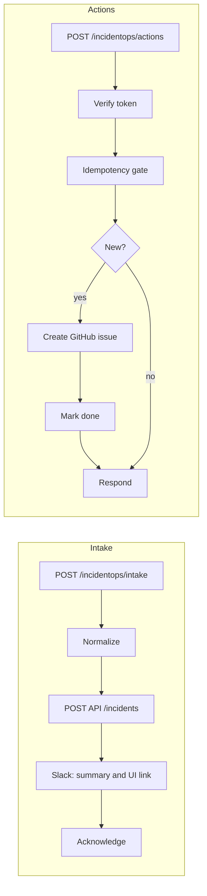

# n8n workflow

n8n owns the Slack and GitHub credentials and performs every write. The Python
service only ever sends it an approved request.

Import `incident-ops.json` through **Workflows → Import from file**, then
activate it.

## Environment values

| Variable | Purpose |
|---|---|
| `INCIDENTOPS_URL` | Base URL of the API as n8n reaches it (`http://api:8000` in Compose) |
| `INCIDENTOPS_API_KEY` | Sent to the API as `X-API-Key` |
| `INCIDENTOPS_PUBLIC_URL` | Where people open the UI; used for the link in Slack |
| `N8N_ACTION_TOKEN` | Shared secret. Must equal the API's `N8N_ACTION_TOKEN` |
| `SLACK_BOT_TOKEN` | Bot allowed to post in the incident channel |
| `GITHUB_TOKEN` | Issue-write token scoped to one repository |
| `GITHUB_REPO` | `owner/repository` |

n8n 2.x blocks `$env` inside nodes by default. Compose sets
`N8N_BLOCK_ENV_ACCESS_IN_NODE=false` because this workflow reads its settings
that way. If you run n8n yourself, set it too.

Set the API's `N8N_ACTION_WEBHOOK_URL` to
`<n8n base>/webhook/incidentops/actions`.

## Flows

**Intake.** Slack events hit `incidentops/intake`. The workflow normalizes the
payload, starts a run through the API, and posts the proposed actions plus a
link to `/#/incidents/<run_id>` into the thread. People decide in the web UI.
There is no approve link in Slack, because a link that changes state on a plain
`GET` can be triggered by a link preview.

**Actions.** After an approval, the API calls `incidentops/actions` with a
`Bearer` token and an `Idempotency-Key`. The workflow checks the token, then the
gate, then creates one GitHub issue listing only the `approved_actions`.

## Idempotency

The gate stores the key in workflow static data in two steps: `done: false` when
the request arrives and `done: true` only after the issue exists. That way:

| Situation | Result |
|---|---|
| Same request twice after success | Second one is skipped, no duplicate issue |
| GitHub failed, API retries | Runs again, because the key was never marked done |
| Two identical requests at the same instant | Could both run; the window is tiny, but see below |

Static data is fine for a demo and a single n8n instance. For production,
replace it with Redis `SET NX` or a database unique constraint, and treat the
GitHub `Idempotency-Key` header as advisory only.

## Hardening checklist before going live

- Verify Slack's request signature (`X-Slack-Signature`) on the intake webhook.
  The template does not, because the signing secret is workspace specific.
- Use a fine-grained GitHub token limited to issues on one repository.
- Keep the actions webhook off the public internet, or at least behind the
  token check as shipped.
- Rotate `N8N_ACTION_TOKEN` and `INCIDENTOPS_API_KEY` together when staff change.

The checked-in file is a portable template. Credential selection and the final
action (GitHub issue here, Jira if you prefer) happen in your n8n instance. See
[../docs/API_CONTRACT.md](../docs/API_CONTRACT.md) for the exact request shape.
